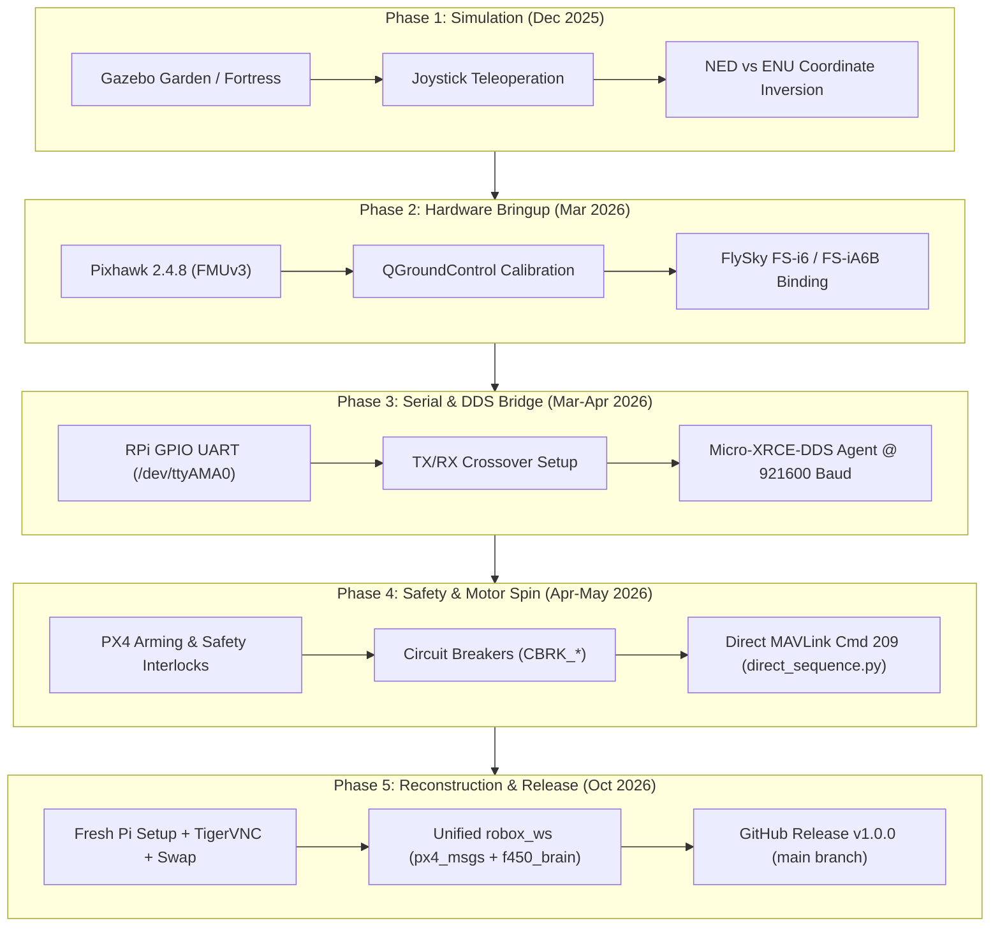

# Autonomous F450 Quadcopter with Pixhawk 2.4.8 & ROS 2 Humble
## Master Retrospective Analysis, Hardware Specification, & System Setup Guide

> [!CAUTION]
> **SAFETY CRITICAL — REMOVE ALL PROPELLERS BEFORE BENCH TESTING!**
> Nodes such as `commander.py`, `verify_motors.py`, and `direct_sequence.py` transmit direct MAVLink motor test overrides and force-arm requests (`param2=21196.0`) with up to 30% thrust. Running these nodes on a bench with propellers attached will cause immediate, violent flipping, physical injury, or hardware destruction.

---

## 1. Executive Summary & 10-Month Timeline (Dec 2025 – Oct 2026)

Over the course of 358 recorded conversation turns spanning from December 9, 2025 to October 26, 2026, the project evolved from basic simulation in Gazebo to a fully integrated physical autonomous drone. The system pairs an **F450 Quadcopter** frame with a **Pixhawk 2.4.8 (FMUv3)** flight controller and a **Raspberry Pi 4 Model B (Companion Computer)** running **Ubuntu 22.04 LTS (Jammy)**, **ROS 2 Humble**, and **Micro-XRCE-DDS-Agent**.



---

## 2. Exhaustive Autopsy of Failures vs. Successes

Every roadblock encountered during the 10-month lifecycle had a specific root cause in firmware logic, electrical wiring, or middleware communications:

| # | Subsystem | Failure Encountered | Technical Root Cause | Resolution & Permanent Fix |
|---|---|---|---|---|
| **1** | **Simulation** | Drone moved up/down but refused forward/lateral translation in Gazebo | PX4 coordinates use **NED** (*North-East-Down*), where negative $Z$ is upward altitude, whereas ROS uses **ENU** (*East-North-Up*). Joystick mappings inverted axes. | Remapped trajectory setpoint coordinates to invert $Z$ velocity and align body frame orientations. |
| **2** | **Gazebo** | Camera/Depth sensor streaming crashed (`/IMX214/image` dropped) | High CPU load on simulation host and Gazebo transport plugin version mismatches between ROS 2 Humble bridge and Gazebo Fortress/Garden. | Dropped virtual camera streaming in simulation to dedicate focus to real hardware bringup. |
| **3** | **Firmware** | Pixhawk 2.4.8 bootloader failed to flash standard `px4_fmu-v5` / v6 targets | Pixhawk 2.4.8 is an **FMUv3** board with STM32F427 hardware. Early silicon suffered from a 1MB flash bug, preventing modern monolithic PX4 images from loading. | Targeted strictly `px4_fmu-v3_default` builds and utilized QGroundControl auto-detection. |
| **4** | **Sensors** | QGroundControl showed permanent red sensor health for Compass / Magnetometer | High electromagnetic interference (EMI) from desktop electronics, steel desk frames, and power supplies indoors. Disabling compass via `EKF2_MAG_TYPE=None` caused EKF to lose Yaw, blocking Attitude mode. | Kept `EKF2_MAG_TYPE` active, calibrated magnetometer away from steel objects, and calibrated 6-point accelerometer. |
| **5** | **UART Hardware** | Total silence on `/dev/ttyAMA0`; MicroXRCEAgent could not see Pixhawk | **1)** Linux kernel had `console=serial0,115200` active on GPIO pins.<br>**2)** Standard serial cables wire TX-to-TX and RX-to-RX rather than crossed. | **1)** Removed serial console from `/boot/firmware/cmdline.txt`.<br>**2)** Swapped Pin 8 (TX) and Pin 10 (RX) so RPi TX $\rightarrow$ Pixhawk RX and vice versa. |
| **6** | **DDS Agent** | Micro-XRCE-DDS-Agent source build crashed on Pi with `invalid reference: 2.12.x` | Upstream eProsima Fast-DDS deleted the `2.12.x` branch in favor of release tags (`v2.12.2`). | Installed pre-compiled ARM64 agent via Snap (`/snap/bin/micro-xrce-dds-agent`) and created `/usr/local/bin/MicroXRCEAgent` wrapper. Configured CMake to use `-DUAGENT_USE_SYSTEM_FASTDDS=ON`. |
| **7** | **ROS 2 Topics** | `ros2 topic echo /fmu/out/...` showed no data despite running bridge | MicroXRCEAgent was executed with `sudo`, which purged user environment variables, reverting the agent to `ROS_DOMAIN_ID=0` while nodes ran on `ROS_DOMAIN_ID=42`. | Added user `drone` to `dialout` group so `sudo` is unnecessary, and permanently set `export ROS_DOMAIN_ID=42` in `~/.bashrc`. |
| **8** | **Safety Check** | `commander.py` showed `Drone is ARMED!`, but physical ESCs remained silent | Pixhawk pre-flight circuit breakers active: **1)** Low LiPo voltage (9.8V), **2)** USB cable connected, **3)** Missing RC transmitter heartbeat, **4)** Missing 3D GPS fix. | Enabled bench-test circuit breakers in QGC: `CBRK_SUPPLY_CHK=894281`, `CBRK_USB_CHK=197848`, `COM_ARM_WO_GPS=1`, `COM_RC_IN_MODE=1`. |
| **9** | **MAVLink Filter** | `direct_sequence.py` motor test commands were silently ignored by PX4 | In initial scripts, `msg.source_system = 1` and `msg.source_component = 1`. PX4 firmware detected loopback from its own ID and rejected the packet. Simultaneously, QGC was fighting for telemetry control. | Updated script headers: `source_system = 255`, `source_component = 191` (Companion Computer), enabled `COM_MOT_TEST_EN = 1`, and closed QGC before test execution. |
| **10** | **System Crash** | Raspberry Pi SD card corruption and complete system failure | SD card wear, abrupt power loss during writing, and 0B swap space causing kernel out-of-memory (OOM) freezing. | Installed fresh Ubuntu 22.04 LTS, configured TigerVNC systemd auto-start, created 4GB persistent swap space, and committed all code to GitHub. |

---

## 3. Hardware Architecture & Electrical Pinout

### 3.1 Pixhawk TELEM2 to Raspberry Pi 4 GPIO Wiring

> [!WARNING]
> **NEVER connect Pin 1 (VCC 5V) of TELEM2 to the Raspberry Pi!**
> The Raspberry Pi must be powered separately via a dedicated 5V/3A UBEC or USB-C supply. Connecting the 5V line between the Pixhawk and Pi creates ground loops and can destroy both boards.

| Pixhawk 2.4.8 TELEM2 Pin | Signal | Wire Color (Standard) | Raspberry Pi 4 Header Pin | RPi GPIO Designation |
|---|---|---|---|---|
| **Pin 1** | VCC 5V | Red | **DO NOT CONNECT** | *Leave Disconnected / Taped* |
| **Pin 2** | TX (Pixhawk Out) | White / Black | **Pin 10 (Physical)** | `GPIO 15 (UART0 RXD)` |
| **Pin 3** | RX (Pixhawk In) | Black / White | **Pin 8 (Physical)** | `GPIO 14 (UART0 TXD)` |
| **Pin 4** | CTS | Gray | **DO NOT CONNECT** | *Unused in 2-wire serial* |
| **Pin 5** | RTS | Orange | **DO NOT CONNECT** | *Unused in 2-wire serial* |
| **Pin 6** | GND | Black | **Pin 6 (Physical)** | `GND (Ground)` |

### 3.2 Quadcopter Actuator & Motor Geometry (Quad-X)

Standard PX4 Quad-X motor layout and numbering:
- **Motor 1 (Front Right)**: Counter-Clockwise (CCW) $\rightarrow$ Pixhawk MAIN OUT 1
- **Motor 2 (Rear Left)**: Counter-Clockwise (CCW) $\rightarrow$ Pixhawk MAIN OUT 2
- **Motor 3 (Front Left)**: Clockwise (CW) $\rightarrow$ Pixhawk MAIN OUT 3
- **Motor 4 (Rear Right)**: Clockwise (CW) $\rightarrow$ Pixhawk MAIN OUT 4

---

## 4. QGroundControl (PX4 1.14) Parameter Reference

When configuring Pixhawk for bench-top companion testing, set the following parameters via QGroundControl:

| Parameter | Value | Functional Category | Purpose & Impact |
|---|---|---|---|
| `UXRCE_DDS_CFG` | `TELEM 2` | Serial Communication | Routes Micro-XRCE-DDS client to the TELEM2 physical UART port. |
| `SER_TEL2_BAUD` | `921600` | Serial Communication | Sets high-speed baud rate for high-frequency (50Hz) telemetry setpoints. |
| `XRCE_DDS_DOM_ID` | `42` | DDS Middleware | Sets PX4 DDS Domain ID to match `export ROS_DOMAIN_ID=42` on Raspberry Pi. |
| `COM_ARM_WO_GPS` | `1` (Allow) | Pre-flight Checks | Allows arming indoors without an external 3D GPS satellite fix. |
| `COM_RC_IN_MODE` | `1` (Disabled) | Failsafe Configuration | Disables the requirement for an active physical RC transmitter link. |
| `COM_MOT_TEST_EN` | `1` (Enabled) | Actuator Safety | Permits external companion computers to trigger MAVLink Command 209 (`VEHICLE_CMD_DO_MOTOR_TEST`). |
| `CBRK_IO_SAFETY` | `22027` | Circuit Breakers | Disables the physical hardware safety button requirement on the GPS mast. |
| `CBRK_USB_CHK` | `197848` | Circuit Breakers | Disables safety lock that prevents arming while a micro-USB cable is plugged in. |
| `CBRK_SUPPLY_CHK` | `894281` | Circuit Breakers | Bypasses power module voltage check (prevents lockout when LiPo is under 10.5V or on bench power). |
| `COM_ARM_SWISBTN` | `1` (Enabled) | Switch Mapping | Treats physical safety switch as momentary toggle rather than latching switch. |
| `EKF2_MAG_TYPE` | `0` (Automatic) | Sensor Fusion | Ensures 3D magnetometer data is fused so EKF can estimate vehicle attitude (Yaw). |

---

## 5. Raspberry Pi 4 System State & Verification

The Raspberry Pi 4 environment has been configured and verified:

```mermaid
graph LR
    subgraph OS["Ubuntu 22.04 LTS (Jammy aarch64)"]
        KERNEL["/boot/firmware/cmdline.txt (No serial console)"]
        CONFIG["/boot/firmware/config.txt (enable_uart=1, disable-bt)"]
        SWAP["4.0 GiB Swap Space (/swapfile active)"]
    end
    subgraph USER["User Environment: drone"]
        DIALOUT["Group: dialout (Direct /dev/ttyAMA0 RW access)"]
        BASHRC["~/.bashrc: ROS_DOMAIN_ID=42, Humble sourced"]
    end
    subgraph WS["ROS 2 Workspace: /home/drone/robox_ws"]
        PX4["px4_msgs (release/1.14 IDLs)"]
        F450["f450_brain (commander, verify_motors, direct_sequence, visualizer)"]
    end
    subgraph DDS["Bridge"]
        AGENT["/usr/local/bin/MicroXRCEAgent (Snap wrapper v2.4.3)"]
    end

    OS --> USER --> WS --> DDS
```



1. **Serial Port**: `/dev/ttyAMA0` is mapped directly to GPIO 14/15 with `enable_uart=1` and `dtoverlay=disable-bt`.
2. **Swap File**: Added `4.0 GiB` swap file at `/swapfile` (persisted in `/etc/fstab`) to eliminate memory pressure.
3. **Environment**: `~/.bashrc` automatically sources `/opt/ros/humble/setup.bash`, `/home/drone/robox_ws/install/setup.bash`, and sets `export ROS_DOMAIN_ID=42`.
4. **Git Repository**: Workspace is committed and synchronized with [`github.com/namanharshwal/px-2.4.8_drone_ros2_humble`](https://github.com/namanharshwal/px-2.4.8_drone_ros2_humble).

---

## 6. Step-by-Step Bench Testing Protocol

### Step 1: Pre-Power Hardware Inspection
1. **Remove all 4 propellers** from the drone frame.
2. Ensure Pixhawk TELEM2 is connected to RPi GPIO Pins 6, 8, and 10.
3. Power the Raspberry Pi via 5V USB-C or UBEC. Connect via TigerVNC (`<Pi_IP>:1`).
4. Connect the 3S/4S LiPo battery to the drone power distribution board (ESCs will emit startup beeps).

### Step 2: Start the Micro-XRCE-DDS Bridge
Open **Terminal 1** on the Raspberry Pi:
```bash
/home/drone/robox_ws/scripts/start_agent.sh
# Or run directly:
MicroXRCEAgent serial --dev /dev/ttyAMA0 -b 921600
```
*Expected Output*: Within 2–5 seconds, the terminal displays:
```text
[Init] Micro XRCE-DDS Agent running...
[Serial] Device /dev/ttyAMA0 opened at 921600 baud.
[Session] Session established with client key: 0x...
```

### Step 3: Verify ROS 2 Telemetry Stream
Open **Terminal 2** to confirm bidirectional communication:
```bash
ros2 topic list | grep fmu
```
*Expected Output*: You should see `/fmu/in/...` and `/fmu/out/...` topics populated. Echo the vehicle status:
```bash
ros2 topic echo /fmu/out/vehicle_status
```

### Step 4: Execute Motor Spin Isolation Test
*Important: Ensure QGroundControl is CLOSED on your laptop during this test.*
```bash
ros2 run f450_brain direct_sequence
```
*Sequence*:
- $t = 2\text{s}$: Front-Right (Motor 1) spins at 15% throttle for 3 seconds.
- $t = 6\text{s}$: Front-Left (Motor 3) spins at 15% throttle for 3 seconds.
- $t = 10\text{s}$: Rear-Left (Motor 2) spins at 15% throttle for 3 seconds.
- $t = 14\text{s}$: Rear-Right (Motor 4) spins at 15% throttle for 3 seconds.
- $t = 18\text{s}$: Test finishes and node shuts down safely.

### Step 5: Execute Autonomous Attitude Tilt Verification
If QGroundControl shows a green `Ready` status and you wish to verify Offboard attitude control:
```bash
ros2 run f450_brain verify_motors
```
This forces the drone into Offboard mode, arms the vehicle, and commands 4 sequential 30° roll/pitch tilts to verify that the flight controller mixer correctly isolates each corner motor under attitude error feedback.
