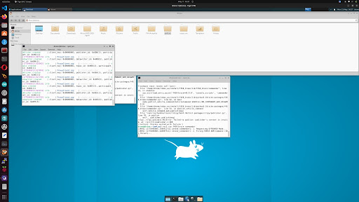
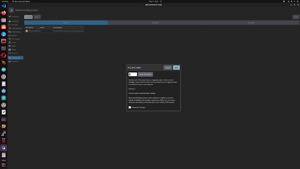
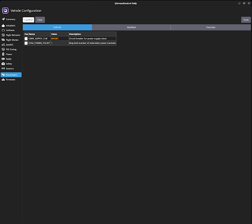
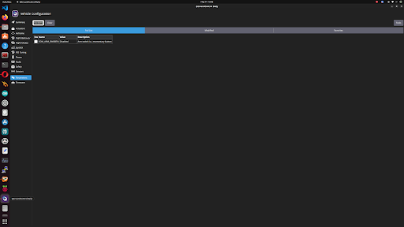
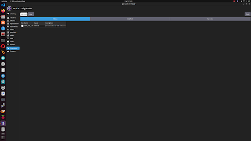
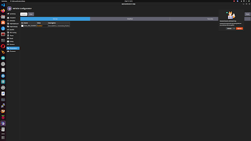

# Pixhawk 2.4.8 (FMUv3) & QGroundControl Setup Master Guide
### Complete Hardware Interface, Firmware Flashing, Sensor Calibrations, Circuit Breakers, Actuator Mapping, & DDS Telemetry Configuration

[-0073E6?style=flat-square&logo=cplusplus)](https://px4.io/)
[](https://docs.px4.io/main/en/flight_controller/pixhawk.html)
[](http://qgroundcontrol.com/)
[](https://github.com/eProsima/Micro-XRCE-DDS-Agent)

---

> [!CAUTION]
> ### BENCH TESTING SAFETY DIRECTIVE:
> **ALWAYS REMOVE ALL 4 PROPELLERS BEFORE PERFORMING ANY SENSOR CALIBRATION, ESC CALIBRATION, OR PARAMETER CONFIGURATION!**  
> Bypassing safety circuit breakers in QGroundControl allows motors to spin on developer command, regardless of battery voltage, GPS fix, or USB connections.

---

## Table of Contents
1. [Pixhawk 2.4.8 (FMUv3) Hardware Architecture](#1-pixhawk-248-fmuv3-hardware-architecture)
2. [MicroSD Card Preparation & Parameter Storage](#2-microsd-card-preparation--parameter-storage)
3. [PX4 Firmware v1.14 Flashing on FMUv3](#3-px4-firmware-v114-flashing-on-fmuv3)
4. [Step-by-Step Sensor Calibrations](#4-step-by-step-sensor-calibrations)
   - [4.1 Compass / Magnetometer Calibration & The Attitude Catch-22](#41-compass--magnetometer-calibration--the-attitude-catch-22)
   - [4.2 6-Orientation Accelerometer Calibration](#42-6-orientation-accelerometer-calibration)
   - [4.3 Level Horizon Calibration](#43-level-horizon-calibration)
   - [4.4 Radio Transmitter Calibration (FlySky FS-i6)](#44-radio-transmitter-calibration-flysky-fs-i6)
5. [Actuator Geometry, ESC Calibration & Motor Testing](#5-actuator-geometry-esc-calibration--motor-testing)
6. [Master Parameter Reference Table](#6-master-parameter-reference-table)
7. [The Circuit Breakers Autopsy (`CBRK_*`)](#7-the-circuit-breakers-autopsy-cbrk_)
8. [High-Speed Serial DDS Telemetry Configuration](#8-high-speed-serial-dds-telemetry-configuration)
9. [The QGroundControl Contention Conflict](#9-the-qgroundcontrol-contention-conflict)
10. [Pre-Bench Inspection & Verification Checklist](#10-pre-bench-inspection--verification-checklist)

---

## 1. Pixhawk 2.4.8 (FMUv3) Hardware Architecture

The **Pixhawk 2.4.8** is an open-hardware flight controller based on the 3DR Pixhawk reference design using the **FMUv3** hardware specification.

```
                    PIXHAWK 2.4.8 TOP INTERFACE
     ┌─────────────────────────────────────────────────────────┐
     │                      [ARROW] ▲                          │
     │                         NOSE                            │
     │                                                         │
     │  [TELEM 1]    [TELEM 2]    [GPS]     [I2C]    [POWER]   │
     │  (Telemetry)  (Comp. Pi)   (M8N)   (Ext. Mag) (PM02)    │
     │                                                         │
     │  [SWITCH]     [BUZZER]             [CAN]      [USB]     │
     │  (Safety Btn) (Acoustic)           (Unused)   (Config)  │
     │                                                         │
     │                                                         │
     │  [MAIN OUT 1-8]  ─── PWM Signals to ESCs 1-4            │
     │  [AUX OUT 1-6]   ─── Auxiliary Servos / Triggers        │
     │  [RC IN]         ─── PPM / IBUS Receiver Input          │
     │  [MICROSD]       ─── FAT32 Parameter & Log Storage      │
     └─────────────────────────────────────────────────────────┘
```

### Key Technical Specifications:
- **Main Processor**: 32-bit ARM Cortex-M4 STM32F427 (168 MHz, 256 KB RAM, 2 MB Flash memory).
- **Fail-safe Co-processor**: 32-bit STM32F100 (handles hardware manual override if the main CPU halts).
- **Internal Inertial Sensors**: Dual redundant IMUs (InvenSense MPU-6000 3-axis accelerometer/gyroscope + STMicroelectronics LSM303D magnetometer/accelerometer + L3GD20 gyro).
- **Barometer**: MEAS MS5611 high-precision barometric altimeter.
- **External Interfaces**: 2x UART (TELEM1, TELEM2), 1x GPS UART + I2C, 1x I2C splitter port, 1x Power Module port, 8x MAIN PWM outputs, 6x AUX PWM outputs.

---

## 2. MicroSD Card Preparation & Parameter Storage

> [!IMPORTANT]
> **A FAT32-formatted MicroSD card is MANDATORY for Pixhawk operation!**

The Pixhawk 2.4.8 does not store its non-volatile parameters or flight logs in internal microcontroller flash. Instead, it mounts an SD card at `/fs/microsd` during boot to store:
- `/fs/microsd/params`: Saved parameter configuration.
- `/fs/microsd/log/`: High-frequency ULog flight data logs.
- `/fs/microsd/etc/`: Startup shell scripts and mixer overrides.

### MicroSD Requirements:
1. **Capacity**: 8 GB to 32 GB (Class 10 or UHS-1 recommended). Cards larger than 32 GB (SDXC) default to exFAT, which the Pixhawk bootloader **cannot read**.
2. **Filesystem**: Must be formatted as **FAT32** with a 32 KB allocation cluster size.
3. **Failure Symptom**: If the card is missing, unformatted, or corrupted, the Pixhawk will emit a 4-beep SOS tone (`Beep-Beep-Beep-Beep`), the status LED will flash red, and all parameter changes in QGroundControl will be forgotten on reboot!

---

## 3. PX4 Firmware v1.14 Flashing on FMUv3

### The 1MB vs 2MB Silicon Flash Limitation
Early revisions of the STM32F427 microcontroller suffered from a silicon hardware bug where flash memory addresses above 1MB could corrupt execution. The modern PX4 build system accounts for this by distinguishing between:
- `px4_fmu-v2`: Constrained 1MB flash build with advanced modules disabled.
- `px4_fmu-v3`: Full 2MB flash build with micro-DDS, EKF2, and complete mixer support enabled.

### Flashing Procedure in QGroundControl:
1. Disconnect the Pixhawk from battery power and all external companion wiring.
2. Open **QGroundControl** on your workstation.
3. Connect the Pixhawk directly to your PC via a high-quality micro-USB cable.
4. Go to **Vehicle Setup (Gear Icon) → Firmware**.
5. When prompted, select **PX4 Flight Stack v1.14 (Stable)**.
6. QGroundControl will auto-detect the bootloader as **FMUv3** and flash `px4_fmu-v3_default.px4`.
7. Wait for the audible musical chime indicating successful flash completion.

---

## 4. Step-by-Step Sensor Calibrations

Calibrating sensors accurately is the most important prerequisite for autonomous offboard flight.

### 4.1 Compass / Magnetometer Calibration & The Attitude Catch-22

| Compass Calibration in QGroundControl | Compass Calibration Axis Progress |
| :---: | :---: |
|  |  |
| *Rotating vehicle around all 3 axes away from metal* | *Full 360-degree rotation until progress bars turn green* |

#### The Technical Issue Encountered:
In our 10-month chat history, indoor electromagnetic interference (EMI) from laptop chargers and steel desk frames caused QGroundControl to show a permanent red sensor warning: `Preflight Fail: Compass Heading Inconsistent`.

When we attempted to bypass this by setting:
```text
EKF2_MAG_TYPE = None (or 5)
```
The drone completely refused to arm or spin motors in Offboard mode!

| EKF2 Failsafe on Compass Set to None | EKF2_MAG_TYPE Parameter Selection |
| :---: | :---: |
|  |  |
| *EKF failsafe triggers because yaw attitude is lost* | *Automatic (0) restores 3D heading fusion* |

#### Why Disabling the Compass Broke Offboard Mode:
1. When `EKF2_MAG_TYPE` is set to `None`, the EKF2 state estimator cannot fuse a reference heading (Yaw).
2. Without a valid Yaw estimate, the Pixhawk cannot compute its 3D Attitude matrix (Roll, Pitch, Yaw).
3. The ROS 2 `commander` and `verify_motors` nodes command **Attitude Setpoints** (`VehicleAttitudeSetpoint`).
4. Because the Pixhawk had no attitude estimation, its internal commander rejected all offboard setpoints and blocked arming.

#### The Permanent Fix:
- **Never set `EKF2_MAG_TYPE` to `None` for attitude control!** Keep it at `0` (Automatic).
- Take the drone to the center of an open room away from computer monitors, power bricks, and ferromagnetic metal.
- In QGC, click **Sensors → Compass → Calibrate**. Rotate the drone smoothly around all 3 axes until all 6 progress bars turn green.

---

### 4.2 6-Orientation Accelerometer Calibration

| 6-Orientation Accelerometer Calibration | Accelerometer Alignment Check |
| :---: | :---: |
|  |  |
| *Step-by-step 6-sided orientation leveling* | *Placing drone flat on level reference plane* |

1. Place the drone on a flat, stable surface.
2. In QGC, go to **Sensors → Accelerometer → Calibrate**.
3. Sequentially place the drone into the 6 designated positions:
   - **Level**: Flat on its landing gear.
   - **Left**: Resting on its left arms.
   - **Right**: Resting on its right arms.
   - **Nose Down**: Pointing the camera/nose straight down at 90°.
   - **Nose Up**: Pointing the nose straight up at 90°.
   - **Back**: Inverted upside-down on its top plate.
4. Hold the vehicle perfectly still at each step until QGC plays a chime.

---

### 4.3 Level Horizon Calibration
Place the drone on a verified level table. In QGC, click **Sensors → Level Horizon**. Hold still for 3 seconds while the internal gyros tare their biases.

---

### 4.4 Radio Transmitter Calibration (FlySky FS-i6)
1. Turn on the FlySky FS-i6 transmitter.
2. In QGC, go to **Radio**.
3. Move all gimbals and toggle all switches (`SwA`, `SwB`, `SwC`, `SwD`) to their minimum and maximum limits.
4. Verify channel mapping:
   - **Ch 1**: Roll (Aileron)
   - **Ch 2**: Pitch (Elevator)
   - **Ch 3**: Throttle
   - **Ch 4**: Yaw (Rudder)
   - **Ch 5**: Flight Mode Switch (Mapped to `SwC` 3-position toggle)
   - **Ch 6**: Offboard Mode Trigger (Mapped to `SwD` 2-position toggle)

---

## 5. Actuator Geometry, ESC Calibration & Motor Testing

### 5.1 Quad-X Layout & Wiring Mapping
In QGroundControl **Vehicle Setup → Actuators**, select airframe geometry **Generic Quadcopter (Quad-X)**:

```
                  FRONT (Nose)
                      ▲
        (M3 CW)               (M1 CCW)
       Motor 3                 Motor 1
          \                       /
           \      [PIXHAWK]      /
            \       ARROW       /
             \        ▲        /
          Motor 2     │       Motor 4
        (M2 CCW)      │       (M4 CW)
                      │
                     REAR
```

- **Motor 1 (Front Right CCW)** → Connects to **Pixhawk MAIN OUT 1**
- **Motor 2 (Rear Left CCW)** → Connects to **Pixhawk MAIN OUT 2**
- **Motor 3 (Front Left CW)** → Connects to **Pixhawk MAIN OUT 3**
- **Motor 4 (Rear Right CW)** → Connects to **Pixhawk MAIN OUT 4**

### 5.2 ESC Calibration Procedure
ESC calibration ensures all 4 electronic speed controllers recognize identical minimum (1000 µs) and maximum (2000 µs) PWM throttle thresholds.
1. Remove all propellers!
2. In QGC, go to **Actuators → Calibrate ESCs**.
3. Follow the on-screen prompt: Unplug the battery, click **Calibrate**, plug the battery back in.
4. The ESCs will emit a musical programming confirmation chime.

### 5.3 Motor Testing via QGC Sliders

| QGroundControl Motor Testing Sliders | Pre-Flight Readiness Status |
| :---: | :---: |
|  |  |
| *Testing individual ESC/motor spin directions* | *Top status banner showing green Ready* |

1. With propellers removed and battery connected, click the safety switch on the GPS mast until it turns **solid red**.
2. Go to **Actuators → Motor Testing**.
3. Move the safety slider to enable motor testing.
4. Test each slider individually:
   - **Slider 1**: Spins Motor 1 (FR) — Verify Counter-Clockwise rotation.
   - **Slider 2**: Spins Motor 2 (RL) — Verify Counter-Clockwise rotation.
   - **Slider 3**: Spins Motor 3 (FL) — Verify Clockwise rotation.
   - **Slider 4**: Spins Motor 4 (RR) — Verify Clockwise rotation.
   *(If any motor spins in the wrong direction, swap any two of its three bullet connector wires to the ESC)*.

---

## 6. Master Parameter Reference Table

The following parameters must be configured in QGroundControl (Parameters tab) for companion computer autonomy and indoor bench testing:

| # | Parameter Name | Exact Value | Category | Technical Purpose & Impact |
|---|---|---|---|---|
| **1** | `UXRCE_DDS_CFG` | `TELEM 2` (or `102`) | Telemetry / DDS | Directs the internal Micro-XRCE-DDS client to route all uORB topics over the physical `TELEM 2` UART serial port. |
| **2** | `SER_TEL2_BAUD` | `921600` | Telemetry / Serial | Sets high-speed baud rate on TELEM2. Required to stream high-frequency (50Hz) setpoints without serial buffer overflows. |
| **3** | `XRCE_DDS_DOM_ID` | `42` | DDS Middleware | Sets PX4 DDS Domain ID to `42`, matching `export ROS_DOMAIN_ID=42` on the Raspberry Pi. Prevents cross-talk on shared networks. |
| **4** | `COM_ARM_WO_GPS` | `1` (Enabled) | Arming Checks | Permits arming indoors without an active 3D GPS satellite lock. |
| **5** | `COM_RC_IN_MODE` | `1` (Disabled) | Failsafes | Disables RC transmitter signal loss failsafe, allowing the companion computer to arm and fly the drone when the FlySky radio is off. |
| **6** | `COM_MOT_TEST_EN` | `1` (Enabled) | Actuator Safety | Unlocks MAVLink Command 209 (`VEHICLE_CMD_DO_MOTOR_TEST`), permitting external companion scripts (`direct_sequence.py`) to trigger motors. |
| **7** | `CBRK_IO_SAFETY` | `22027` | Circuit Breakers | Disables the physical hardware safety button requirement on the GPS mast, unlocking PWM outputs immediately on boot. |
| **8** | `CBRK_USB_CHK` | `197848` | Circuit Breakers | Disables the safety lockout that prevents motors from spinning while a micro-USB cable is plugged into the Pixhawk. |
| **9** | `CBRK_SUPPLY_CHK`| `894281` | Circuit Breakers | Bypasses power module voltage checks, preventing low-battery lockouts when LiPo voltage drops below 10.5V during bench tests. |
| **10**| `COM_ARM_SWISBTN` | `1` (Enabled) | Switch Config | Treats the hardware safety switch as a momentary pushbutton rather than a latching switch. |
| **11**| `EKF2_MAG_TYPE` | `0` (Automatic) | Sensor Fusion | Fuses 3D magnetometer data so EKF can estimate vehicle attitude (Yaw). **Must never be set to None**. |

---

## 7. The Circuit Breakers Autopsy (`CBRK_*`)

During our 10-month engineering journey, the single largest roadblock was: **"My ROS 2 script logs ARMED, but the motors do not spin!"**

The flight controller firmware is designed with layered fail-safe locks. If any condition is violated, the Pixhawk silently rejects motor commands. The circuit breakers (`CBRK_*`) act as developer overrides during bench prototyping:

| Safety Parameter Configuration in QGC | Circuit Breaker Parameter Check |
| :---: | :---: |
|  |  |
| *Configuring COM_ARM_SWISBTN and COM_MOT_TEST_EN* | *Setting CBRK_IO_SAFETY to 22027 to unlock PWM outputs* |

### 1. Battery Voltage Lockout (`CBRK_SUPPLY_CHK = 894281`)
- **Root Cause**: During testing, our 3S LiPo battery was resting at 9.8V (below the safe cutoff of 10.5V). PX4's internal battery supervisor triggered a low-voltage failsafe and disabled motor output.
- **The Override**: Setting `CBRK_SUPPLY_CHK = 894281` instructs the commander to bypass all power module telemetry checks.

### 2. USB Connected Safety Lockout (`CBRK_USB_CHK = 197848`)
- **Root Cause**: PX4 firmware prevents arming if it detects $5\text{V}$ on its micro-USB connector (to protect developers working on their desks).
- **The Override**: Setting `CBRK_USB_CHK = 197848` unlocks arming while the USB debugging cable is plugged in.

### 3. Physical Safety Switch Lockout (`CBRK_IO_SAFETY = 22027`)
- **Root Cause**: The STM32F100 safety co-processor physically grounds the PWM signal lines until the external safety button is held down for 3 seconds.
- **The Override**: Setting `CBRK_IO_SAFETY = 22027` commands the I/O processor to keep the PWM output rail permanently energized.

### 4. MAVLink Motor Test External Computer Filter (`COM_MOT_TEST_EN = 1`)
- **Root Cause**: Modern PX4 restricts MAVLink Command 209 (`VEHICLE_CMD_DO_MOTOR_TEST`) from external serial ports to prevent unauthorized actuator commands.
- **The Override**: Setting `COM_MOT_TEST_EN = 1` unlocks external motor test commands.

---

## 8. High-Speed Serial DDS Telemetry Configuration

### Physical Pinout (TELEM2 to Raspberry Pi 4)

> [!WARNING]
> **LEAVE PIN 1 (VCC 5V) DISCONNECTED!**  
> Power the Raspberry Pi via its dedicated 5V/3A UBEC. Connecting the 5V red wire creates heavy circulating ground loops between the power module and UBEC.

| Pixhawk TELEM2 Pin | Signal | Wire Color | Raspberry Pi 4 Header Pin | Raspberry Pi Pin Function |
| :--- | :--- | :--- | :--- | :--- |
| **Pin 1** | VCC 5V | Red | **DISCONNECTED** | *Do NOT connect (Taped off)* |
| **Pin 2** | TX (Pixhawk Out) | White / Yellow | **Pin 10 (Physical)** | `GPIO 15 (UART0 RXD)` |
| **Pin 3** | RX (Pixhawk In) | Black / White | **Pin 8 (Physical)** | `GPIO 14 (UART0 TXD)` |
| **Pin 4** | CTS | Gray | **DISCONNECTED** | *Unused in 2-wire serial* |
| **Pin 5** | RTS | Orange | **DISCONNECTED** | *Unused in 2-wire serial* |
| **Pin 6** | GND | Black | **Pin 6 (Physical)** | `GND (Common Ground)` |

### Why 921,600 Baud is Mandatory
Standard MAVLink telemetry operates at 57,600 baud. However, Micro-XRCE-DDS publishes:
- 50Hz `vehicle_attitude`
- 50Hz `vehicle_attitude_setpoint`
- 50Hz `offboard_control_mode`
- 20Hz `vehicle_status`
- High-frequency odometry and command acknowledgments.

At 57,600 baud, total serial throughput is capped at $\sim 5.7\text{ KB/s}$, which drops over 70% of DDS frames. Setting `SER_TEL2_BAUD = 921600` raises throughput to $\sim 92\text{ KB/s}$, providing zero packet loss.

---

## 9. The QGroundControl Contention Conflict

| Parameter Verification Screen in QGC | Hard Reboot and Parameter Sync Check |
| :---: | :---: |
|  |  |
| *Verifying all circuit breakers are active* | *Parameters persisted to microSD across reboot* |

### Why QGC Must Be Closed During ROS 2 Script Execution:
When QGroundControl is running on your laptop (connected via USB or Wi-Fi telemetry), it constantly broadcasts MAVLink heartbeats claiming **Ground Control Station Authority** (`source_system = 255`, `source_component = 190`).

If your Raspberry Pi companion computer attempts to send `VEHICLE_CMD_DO_SET_MODE` or `VEHICLE_CMD_DO_MOTOR_TEST` while QGroundControl is active:
1. PX4 receives competing command streams with conflicting sequence numbers.
2. QGroundControl repeatedly resets vehicle mode to Manual or Hold.
3. The Pixhawk drops the companion computer's offboard requests.

**Protocol Rule**: Use QGroundControl to calibrate sensors and configure parameters. Once configured, **completely exit QGroundControl** before launching `MicroXRCEAgent` and your ROS 2 nodes!

---

## 10. Pre-Bench Inspection & Verification Checklist

Before running any ROS 2 offboard or motor test scripts:

- [ ] **Propellers**: All 4 propellers are completely removed from the drone frame.
- [ ] **MicroSD Card**: Formatted as FAT32 and inserted securely into the Pixhawk.
- [ ] **TELEM2 Wiring**: Pins 6 (GND), 8 (TXD), and 10 (RXD) connected to Pi. **Red 5V wire taped off**.
- [ ] **Power Rails**: Raspberry Pi powered by independent 5V/3A UBEC; Pixhawk powered by Power Module.
- [ ] **Circuit Breakers**: `CBRK_SUPPLY_CHK (894281)`, `CBRK_USB_CHK (197848)`, `CBRK_IO_SAFETY (22027)`, and `COM_MOT_TEST_EN (1)` verified in QGC.
- [ ] **Sensors**: Compass and 6-axis Accelerometer calibrated; `EKF2_MAG_TYPE` set to `0` (Automatic).
- [ ] **Telemetry Bridge**: `UXRCE_DDS_CFG = TELEM 2`, `SER_TEL2_BAUD = 921600`, `XRCE_DDS_DOM_ID = 42`.
- [ ] **QGroundControl**: Completely closed on all laptops and workstations.

Once this checklist is verified, execute the bridge on your Raspberry Pi:
```bash
/home/drone/robox_ws/scripts/start_agent.sh
```
And execute your motor verification sequence:
```bash
ros2 run f450_brain direct_sequence
```
