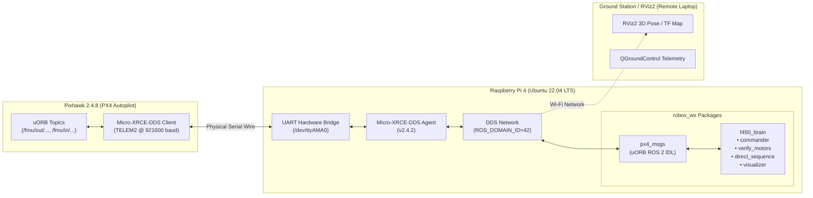

# PX4 2.4.8 F450 Drone Autonomous Flight & Verification Workspace (ROS 2 Humble)

[](https://docs.ros.org/en/humble/)
[](https://px4.io/)
[](https://docs.px4.io/)
[](#)

Unified ROS 2 Humble workspace (`robox_ws`) for autonomous control, motor verification, real-time visualization, and telemetry bridge on an **F450 Quadcopter** equipped with a **Pixhawk 2.4.8 Flight Controller** and an onboard **Raspberry Pi 4 (Ubuntu 22.04 LTS)** companion computer.

---

## ⚠️ CRITICAL SAFETY NOTICE

> [!CAUTION]
> **ALWAYS REMOVE ALL PROPELLERS BEFORE PERFORMING ANY BENCH TESTS OR EXECUTING THESE NODES!**
> The nodes in this workspace execute **force-arm commands (`param2=21196.0`)** and attitude tilt thrust setpoints. Never power on the motors with propellers attached while connected to a workbench.

---

## 📐 System Architecture



---

## 🔌 Hardware Wiring & Pinout

The Raspberry Pi 4 communicates with the Pixhawk 2.4.8 via a physical serial UART link connecting the Pixhawk's **TELEM2** port to the Pi's GPIO 40-pin header:

| Pixhawk 2.4.8 TELEM2 Pin | Signal | Raspberry Pi 4 Header Pin | BCM GPIO | Notes |
|:---|:---|:---|:---|:---|
| **Pin 1** | VCC (+5V) | *NC (Do NOT connect)* | - | Power Pi via dedicated 5V 3A UBEC |
| **Pin 2** | TX (Telemetry Out) | **Pin 10** | GPIO 15 (RXD0) | Serial data from Pixhawk to Pi |
| **Pin 3** | RX (Telemetry In) | **Pin 8** | GPIO 14 (TXD0) | Serial data from Pi to Pixhawk |
| **Pin 4** | CTS | *NC (Not Connected)* | - | Flow control disabled |
| **Pin 5** | RTS | *NC (Not Connected)* | - | Flow control disabled |
| **Pin 6** | GND (Ground) | **Pin 6** | Ground | Common reference ground (Essential) |

Serial interface on Raspberry Pi 4: `/dev/ttyAMA0` (or `/dev/serial0`).

---

## ⚙️ Pixhawk Parameter Configuration (QGroundControl)

In **QGroundControl**, set the following parameters to enable the Micro-XRCE-DDS bridge:

| Parameter | Recommended Value | Purpose |
|:---|:---|:---|
| `UXRCE_DDS_CFG` | `TELEM2` (or port `102`) | Assigns Micro-XRCE-DDS client to TELEM2 |
| `SER_TEL2_BAUD` | `921600` | Baud rate for serial telemetry |
| `XRCE_DDS_DOM_ID` | `42` | DDS Domain ID (Must match `ROS_DOMAIN_ID`) |
| `COM_RCL_EXCEPT` | `4` | Prevents failsafe triggers when RC is absent in Offboard mode |

*Note: Reboot Pixhawk after modifying parameters for changes to take effect.*

---

## 📦 Workspace Package Contents

```
robox_ws/
├── .gitignore
├── README.md
├── scripts/
│   ├── build_micro_xrce_agent.sh   # Builds and installs Micro-XRCE-DDS-Agent
│   └── start_agent.sh              # Sets permissions and launches the agent
└── src/
    ├── px4_msgs/                   # PX4 uORB message definitions for ROS 2 Humble
    └── f450_brain/                 # Autopilot, testing, and visualization package
        ├── config/
        ├── launch/
        │   └── drone_bringup.launch.py
        ├── f450_brain/
        │   ├── __init__.py
        │   ├── commander.py        # Offboard arming & setpoint stream (30% thrust)
        │   ├── verify_motors.py    # 4-corner attitude tilt sequence (isolates M1-M4)
        │   ├── direct_sequence.py  # Direct ESC test via VEHICLE_CMD_DO_MOTOR_TEST
        │   └── visualizer.py       # TF 'map' -> 'base_link' & /drone/pose for RViz2
        ├── package.xml
        ├── setup.cfg
        └── setup.py
```

### Nodes in `f450_brain`:

1. **`commander`** (`commander.py`):
   Streams `OffboardControlMode` and `VehicleAttitudeSetpoint` at 50 Hz. Requests Offboard mode, executes Force-Arming, runs at 30% thrust, and safely disarms.
2. **`verify_motors`** (`verify_motors.py`):
   Tilts the attitude target sequentially (Front-Right, Front-Left, Rear-Left, Rear-Right) at 25% thrust to dynamically verify mixer assignment and motor direction.
3. **`direct_sequence`** (`direct_sequence.py`):
   Commands PX4 actuator test via `VEHICLE_CMD_DO_MOTOR_TEST` to spin each ESC individually at 15% throttle for 3 seconds without arming flight controllers.
4. **`visualizer`** (`visualizer.py`):
   Subscribes to `/fmu/out/vehicle_attitude`, converts PX4 NED quaternions to ROS ENU coordinates, and broadcasts `map` → `base_link` transforms and `/drone/pose` for live RViz2 tracking.

---

## 🚀 Quick Start Guide

### 1. Build Micro-XRCE-DDS Agent

```bash
cd ~/robox_ws/scripts
chmod +x build_micro_xrce_agent.sh start_agent.sh
./build_micro_xrce_agent.sh
```

### 2. Build the Workspace

```bash
cd ~/robox_ws
source /opt/ros/humble/setup.bash
colcon build --symlink-install
```

### 3. Source Environment

Add the workspace to your `~/.bashrc`:

```bash
echo "source /opt/ros/humble/setup.bash" >> ~/.bashrc
echo "source ~/robox_ws/install/setup.bash" >> ~/.bashrc
echo "export ROS_DOMAIN_ID=42" >> ~/.bashrc
source ~/.bashrc
```

---

## 🕹️ Running the System

### Step 1: Start the Micro-XRCE-DDS Agent (Terminal 1)

```bash
# Set UART permissions and start bridge
sudo chmod 666 /dev/ttyAMA0
MicroXRCEAgent serial --dev /dev/ttyAMA0 -b 921600
```
*Wait until you see:* `Session established`.

### Step 2: Verify Active Topics (Terminal 2)

```bash
source ~/robox_ws/install/setup.bash
ros2 topic list
```
You should see `/fmu/out/vehicle_status`, `/fmu/out/vehicle_attitude`, etc.

### Step 3: Run Verification Tests (PROPELLERS OFF!)

```bash
# Test 1: Direct sequential ESC spin test (15% throttle)
ros2 run f450_brain direct_sequence

# Test 2: Sequential attitude tilt motor isolation test
ros2 run f450_brain verify_motors

# Test 3: Offboard commander test
ros2 run f450_brain commander
```

### Step 4: RViz2 Visualization

Launch the visualizer node on the Pi:
```bash
ros2 run f450_brain visualizer
```

On your ground station computer (laptop connected to same Wi-Fi network with `ROS_DOMAIN_ID=42`):
```bash
rviz2
```
Add **TF** and **Axes** displays with Fixed Frame set to `map` to monitor the drone's orientation in real time.

---

## 📄 License
This repository is released under the **Apache-2.0 License**.
