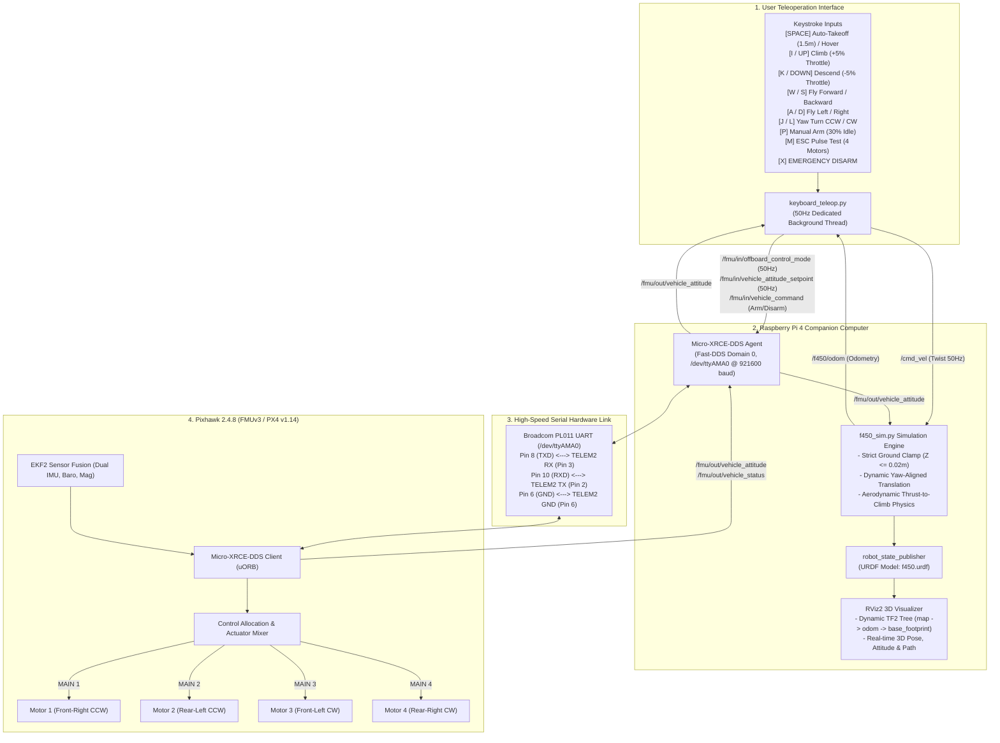
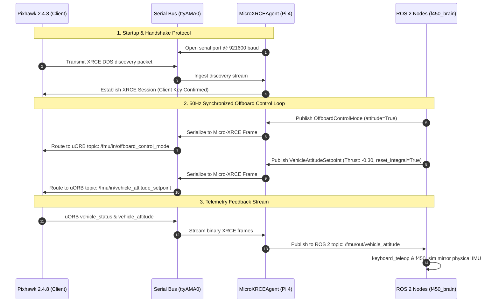
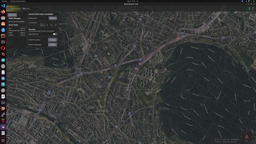
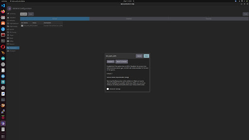
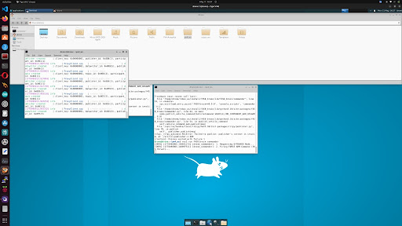
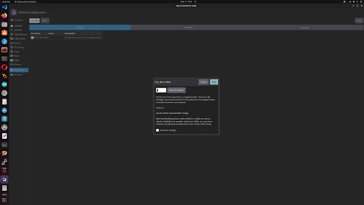

# Autonomous F450 Quadcopter with Pixhawk 2.4.8, ROS 2 Humble & 3D Digital Twin Simulation
## The Complete Engineering Field Manual: Hardware Build, 6-DOF Simulation Engine, Real-Time Hardware Teleoperation, Middleware Architecture, & 10-Month Retrospective

[](https://docs.ros.org/en/humble/)
[-0073E6?style=flat-square&logo=cplusplus)](https://px4.io/)
[](https://docs.px4.io/main/en/flight_controller/pixhawk.html)
[](https://www.raspberrypi.com/)
[](https://github.com/namanharshwal/px-2.4.8_drone_ros2_humble)
[](https://github.com/namanharshwal/px-2.4.8_drone_ros2_humble)
[](https://github.com/eProsima/Micro-XRCE-DDS-Agent)
[](https://www.eprosima.com/)
[](LICENSE)

---

> [!TIP]
> **DEDICATED FLIGHT CONTROLLER & QGC GUIDE:**  
> For the standalone Pixhawk 2.4.8 hardware guide, QGroundControl parameter reference, sensor calibrations, and circuit breaker autopsies, see:  
> 📖 **[`PIXHAWK_2.4.8_QGC_SETUP.md`](PIXHAWK_2.4.8_QGC_SETUP.md)**

---

> [!CAUTION]
> ### CRITICAL BENCH TESTING SAFETY DIRECTIVE:
> **ALWAYS REMOVE ALL 4 PROPELLERS BEFORE RUNNING BENCH TESTS!**  
> Nodes in this package command raw MAVLink actuator overrides and force-arming sequences (`param2=21196.0`) with up to 35% throttle and 30° roll/pitch attitude tilts. If propellers are attached while testing on a bench or indoors, the drone will violently flip, causing severe physical lacerations, severed wiring, or permanent motor damage.

---

## Table of Contents
1. [Executive Summary & System Architecture](#1-executive-summary--system-architecture)
2. [Complete Hardware Bill of Materials (BOM)](#2-complete-hardware-bill-of-materials-bom)
3. [Physical Assembly & Mechanical Construction](#3-physical-assembly--mechanical-construction)
4. [Electrical Wiring & Interconnect Diagrams](#4-electrical-wiring--interconnect-diagrams)
5. [Raspberry Pi 4 Operating System & Environment Hardening](#5-raspberry-pi-4-operating-system--environment-hardening)
6. [Micro-XRCE-DDS Middleware Architecture](#6-micro-xrce-dds-middleware-architecture)
7. [PX4 Firmware & QGroundControl Configuration Master Guide](#7-px4-firmware--qgroundcontrol-configuration-master-guide)
8. [3D Digital Twin Simulation & Hardware-in-the-Loop Architecture](#8-3d-digital-twin-simulation--hardware-in-the-loop-architecture)
9. [Interactive Keyboard Teleoperation & Avionics HUD](#9-interactive-keyboard-teleoperation--avionics-hud)
10. [Synchronized 4-Motor Arming & PID Windup Prevention](#10-synchronized-4-motor-arming--pid-windup-prevention)
11. [The 10-Month Engineering Retrospective (7 Detailed Case Studies)](#11-the-10-month-engineering-retrospective-7-detailed-case-studies)
12. [ROS 2 Workspace Architecture & Node Reference](#12-ros-2-workspace-architecture--node-reference)
13. [Comprehensive Command Reference Manual (Every Command with Descriptions)](#13-comprehensive-command-reference-manual-every-command-with-descriptions)
14. [Bench Testing & Flight Verification Protocol](#14-bench-testing--flight-verification-protocol)
15. [Individual Motor Isolation & Diagnostic Suite](#15-individual-motor-isolation--diagnostic-suite)
16. [Physical Pre-Flight Checklist & Safety Protocols](#16-physical-pre-flight-checklist--safety-protocols)
17. [Intelligent Engineering Q&A Knowledge Base](#17-intelligent-engineering-qa-knowledge-base)
18. [Troubleshooting Runbook](#18-troubleshooting-runbook)
19. [Quick Start & One-Click Launchers](#19-quick-start--one-click-launchers)
20. [License, Copyright & Authorship](#20-license-copyright--authorship)

---

## 1. Executive Summary & System Architecture

This repository hosts the complete, battle-tested autonomous software and hardware implementation for an **F450 Quadcopter** managed by a **Pixhawk 2.4.8 (FMUv3)** flight controller paired with an onboard **Raspberry Pi 4 Model B (4GB)** companion computer running **Ubuntu 22.04 LTS (Jammy Jellyfish)** and **ROS 2 Humble**.

### Unified Hybrid Pipeline: Physical Hardware + 3D RViz Digital Twin
The system unites physical multirotor avionics with a real-time **3D Digital Twin Simulation in RViz2**:
- **Hardware Layer**: High-speed Broadcom UART (`/dev/ttyAMA0` at 921,600 baud) bridges the Pixhawk's internal uORB messaging bus directly to ROS 2 Humble using the **eProsima Micro-XRCE-DDS Agent**.
- **Simulation Layer**: A customized 6-DOF dynamic engine (`f450_sim.py`) mirrors the physical Pixhawk IMU attitude in real time, applies realistic multirotor climb dynamics, strict ground clamping ($Z \le 0.02\,\text{m}$), and dynamic yaw-aligned coordinate translation.
- **Control Layer**: An interactive keyboard teleoperation HUD (`keyboard_teleop.py`) streams commands at 50Hz simultaneously to the physical Pixhawk flight controller (arming, throttle, attitude) and to the simulation visualizer.



---

## 2. Complete Hardware Bill of Materials (BOM)

| Component | Model / Specification | Purpose & Technical Description |
| :--- | :--- | :--- |
| **Airframe** | DJI F450 FlameWheel Replica | 450mm diagonal wheelbase; composite polyamide arms; integrated copper PDB on bottom plate. |
| **Flight Controller** | Pixhawk 2.4.8 (FMUv3) | 32-bit STM32F427 Cortex-M4 with FPU (168MHz / 256KB RAM / 2MB Flash), dual IMU, MS5611 barometer. |
| **Companion Computer**| Raspberry Pi 4 Model B (4GB) | Broadcom BCM2711 quad-core Cortex-A72 @ 1.5GHz; 64-bit Ubuntu 22.04 LTS; 4GB active swap space. |
| **Motors** | 4x 2212 920KV Brushless DC | Rated for 3S–4S LiPo; 920 RPM/V; self-tightening CW/CCW aluminum threaded prop nuts. |
| **ESCs** | 4x 30A SimonK / BLHeli | High-frequency PWM input connected to Pixhawk MAIN OUT 1–4; capable of 40A burst. |
| **Propellers** | 1045 (10x4.5 inch) | 2x Clockwise (CW) + 2x Counter-Clockwise (CCW). *Never installed during bench tests!* |
| **Battery** | 3S (11.1V) / 4S (14.8V) LiPo | 2200mAh – 4500mAh 30C discharge rate with XT60 connector. |
| **Power Distribution**| Integrated Bottom Plate PDB | Glass-fiber plate with heavy copper traces for ESC power leads and battery inputs. |
| **Power Module** | Pixhawk PM02 (XT60) | Provides battery voltage divider (10.1:1) and current shunt (17:1) telemetry to Pixhawk. |
| **Pi Regulator (UBEC)**| Dedicated 5V / 3A DC-DC Buck | Steps down LiPo voltage to clean, isolated 5V via USB-C to power the Raspberry Pi independently. |
| **RC Transmitter** | FlySky FS-i6 (AFHDS 2A) | 6-channel 2.4GHz digital telemetry transmitter with dual gimbals and 4 auxiliary switches. |
| **RC Receiver** | FlySky FS-iA6B | 6-channel receiver connected to Pixhawk RC IN via PPM or IBUS protocol. |
| **GPS & Magnetometer**| U-Blox NEO-M8N + QMC5883L | High-precision GNSS receiver mounted on a 15cm elevated mast to isolate magnetometer from motor EMI. |
| **Safety Switch** | Pixhawk Momentary Pushbutton | Safety switch with integrated high-brightness red LED and acoustic warning buzzer. |

---

## 3. Physical Assembly & Mechanical Construction

### 3.1 Frame Assembly & Motor Orientation
1. **Center Plate Soldering**: Solder the 4 ESC positive (Red) and negative (Black) power leads directly to the integrated copper pads on the F450 bottom plate using 60/40 rosin-core solder. Solder the main battery XT60 pigtail to the rear battery tabs. Verify there are zero solder bridges with a digital multimeter continuity test.
2. **Arm Attachment**: Fasten the 4 composite arms (2 red for front, 2 white for rear) to the bottom plate using M2.5x6 hex screws. Apply a small drop of medium-strength blue thread-locker (Loctite 242) to every screw.
3. **Motor Installation**: Mount the 4x 2212 920KV motors onto the arm ends using M3x8 countersunk screws. 
   - Note the thread direction on the motor shafts: Black nuts correspond to CCW motor rotation, silver nuts correspond to CW rotation.
4. **Top Center Plate**: Route all ESC signal cables toward the center, place the top plate, and secure with M2.5x6 screws.

### 3.2 Pixhawk Flight Controller Mounting
- Mount the Pixhawk in the exact center of gravity (CG) of the frame using **anti-vibration foam pads** (vibration damping platform).
- Ensure the **white forward arrow** on the Pixhawk top case points strictly toward the front arms (between Motor 1 and Motor 3).

### 3.3 GPS & Magnetometer Mast Installation
- Mount the GPS mast on the rear center plate.
- Secure the U-Blox NEO-M8N puck to the top of the 15cm mast using double-sided foam tape.
- **Critical**: Ensure the directional arrow on the GPS puck points strictly **FORWARD**, exactly parallel to the Pixhawk flight controller arrow. An orientation mismatch will cause immediate EKF2 yaw divergence!

---

## 4. Electrical Wiring & Interconnect Diagrams

### 4.1 Pixhawk TELEM2 to Raspberry Pi 4 GPIO Wiring

> [!WARNING]
> **NEVER CONNECT PIN 1 (VCC 5V) BETWEEN PIXHAWK AND RASPBERRY PI!**  
> The Raspberry Pi must be powered exclusively via its dedicated 5V/3A UBEC or USB-C supply. Connecting the 5V line between the Pixhawk and Raspberry Pi creates ground loops, back-powers the flight controller rail, and causes brownouts or hardware damage.

| Pixhawk 2.4.8 TELEM2 Pin | Signal | Standard Wire Color | Raspberry Pi 4 Header Pin | Raspberry Pi Pin Function |
| :--- | :--- | :--- | :--- | :--- |
| **Pin 1** | VCC 5V | Red | **LEAVE DISCONNECTED** | *Do NOT connect (Taped off)* |
| **Pin 2** | TX (Pixhawk Out) | White / Yellow | **Pin 10 (Physical)** | `GPIO 15 (UART0 RXD)` |
| **Pin 3** | RX (Pixhawk In) | Black / White | **Pin 8 (Physical)** | `GPIO 14 (UART0 TXD)` |
| **Pin 4** | CTS | Gray | **LEAVE DISCONNECTED** | *Unused in 2-wire serial* |
| **Pin 5** | RTS | Orange | **LEAVE DISCONNECTED** | *Unused in 2-wire serial* |
| **Pin 6** | GND | Black | **Pin 6 (Physical)** | `GND (Common Ground)` |

```
Pixhawk TELEM2 Port (6-Pin JST-GH)           Raspberry Pi 4 Header (40-Pin GPIO)
┌────────────────────────────────┐           ┌────────────────────────────────┐
│ [1] VCC 5V  (Red)   ───X (Tape)│           │                                │
│ [2] TXD     (White) ───────────┼───────────► Pin 10 (GPIO 15 / RXD)        │
│ [3] RXD     (Black) ◄──────────┼───────────┼─ Pin 8  (GPIO 14 / TXD)        │
│ [4] CTS     (Gray)  ───X (Tape)│           │                                │
│ [5] RTS     (Orange)───X (Tape)│           │                                │
│ [6] GND     (Black) ───────────┼───────────► Pin 6  (GND / Common Ground)   │
└────────────────────────────────┘           └────────────────────────────────┘
```

### 4.2 Quad-X Motor Geometry & Rotation Directions

PX4 uses standard Quad-X actuator mapping:

```
                  FRONT (Nose)
                      ▲
                      │
        (M3 CW)               (M1 CCW)
       Motor 3                 Motor 1
          \                       /
           \                     /
            \       PIXHAWK     /
             \      [ARROW]    /
              \        ▲      /
               \       │     /
                \           /
                 \         /
                  \       /
                   \     /
          Motor 2   \   /   Motor 4
        (M2 CCW)     \ /    (M4 CW)
                      │
                     REAR
```

- **Motor 1 (Front Right)**: Rotates Counter-Clockwise (CCW) → Connects to **Pixhawk MAIN OUT 1**
- **Motor 2 (Rear Left)**: Rotates Counter-Clockwise (CCW) → Connects to **Pixhawk MAIN OUT 2**
- **Motor 3 (Front Left)**: Rotates Clockwise (CW) → Connects to **Pixhawk MAIN OUT 3**
- **Motor 4 (Rear Right)**: Rotates Clockwise (CW) → Connects to **Pixhawk MAIN OUT 4**

*Signal Pin Orientation*: On the Pixhawk 2.4.8 output rail, the **Signal** pin is on the bottom (marked `S` or `⎍`), the **5V Power** pin is in the center, and the **Ground** pin is on the top (marked `-`).

---

## 5. Raspberry Pi 4 Operating System & Environment Hardening

### 5.1 Linux Kernel & Serial Header Configuration
To guarantee that the Broadcom PL011 hardware UART (`/dev/ttyAMA0`) is dedicated exclusively to the Pixhawk Micro-XRCE-DDS bridge without interference:

1. **Remove Linux Kernel Serial Console**:
   Edit `/boot/firmware/cmdline.txt` to remove `console=serial0,115200`. The resulting line must read:
   ```bash
   multipath=off dwc_otg.lpm_enable=0 console=tty1 root=LABEL=writable rootfstype=ext4 rootwait fixrtc cfg80211.ieee80211_regdom=IN ds=nocloud
   ```
2. **Enable Hardware UART and Disable Bluetooth**:
   Ensure `/boot/firmware/config.txt` contains:
   ```ini
   enable_uart=1
   dtoverlay=disable-bt
   arm_64bit=1
   ```

### 5.2 4.0 GiB Persistent Swap File Setup
A 4GB Raspberry Pi 4 running Ubuntu 22.04 LTS can exhaust physical RAM during colcon builds or high-frequency DDS message buffering, triggering the Linux OOM killer:
```bash
sudo fallocate -l 4G /swapfile
sudo chmod 600 /swapfile
sudo mkswap /swapfile
sudo swapon /swapfile
echo '/swapfile none swap sw 0 0' | sudo tee -a /etc/fstab
```

### 5.3 User Permissions & Environment Sourcing
Add user `drone` to the `dialout` group to enable passwordless access to `/dev/ttyAMA0`:
```bash
sudo usermod -aG dialout,gpio,i2c drone
```

Add automated ROS 2 environment sourcing to `~/.bashrc`:
```bash
source /opt/ros/humble/setup.bash
source /home/drone/robox_ws/install/setup.bash
export ROS_DOMAIN_ID=0
```

---

## 6. Micro-XRCE-DDS Middleware Architecture

The communication pipeline between the Pixhawk microcontroller and the Raspberry Pi is managed by **eProsima Micro-XRCE-DDS**.



---

## 7. PX4 Firmware & QGroundControl Configuration Master Guide

### 7.1 Flashing Firmware on Pixhawk 2.4.8 (FMUv3)
Pixhawk 2.4.8 is built on the **FMUv3** hardware definition (STM32F427 microcontroller). When flashing via QGroundControl:
1. Connect Pixhawk via USB directly to your laptop/workstation.
2. Open QGroundControl → Vehicle Setup → Firmware.
3. Select **PX4 Flight Stack v1.14** (Default / Stable).

### 7.2 Sensor Calibrations (Step-by-Step with Screenshots)

| Compass Magnetometer Calibration | 6-Orientation Accelerometer Calibration |
| :---: | :---: |
|  |  |
| *Rotating vehicle around all 3 axes away from metal* | *Step-by-step 6-sided orientation leveling* |

| Compass Calibration Progress | Accelerometer Calibration Alignment |
| :---: | :---: |
|  |  |
| *Full axis rotation until all bars turn green* | *Placing drone flat on level reference plane* |

1. **Compass / Magnetometer Calibration**:
   - Navigate to **Sensors → Compass**.
   - Click **Calibrate** and rotate the drone around all 3 axes (Roll, Pitch, Yaw) until all progress bars turn green.
   - *Crucial*: Perform this calibration in the center of an open room, far from laptop power supplies, metal table legs, and high-power cables.
2. **Accelerometer Calibration**:
   - Navigate to **Sensors → Accelerometer**.
   - Place the drone sequentially in the 6 designated orientations: Level, Left Side, Right Side, Nose Down, Nose Up, Back. Hold still at each position until QGroundControl chimes.
3. **Level Horizon Calibration**:
   - Place the drone on a perfectly level surface and click **Level Horizon**.
4. **Radio Calibration**:
   - Turn on the FlySky FS-i6 transmitter. Move all sticks and flip all switches to their extreme limits until the blue bars trace the complete range (1000 µs – 2000 µs).

### 7.3 Master Parameter Configuration Matrix

Configure the following parameters in QGroundControl (Parameters tab):

| Parameter | Configured Value | Category | Purpose & Technical Impact |
| :--- | :--- | :--- | :--- |
| `UXRCE_DDS_CFG` | `TELEM 2` | Serial Communication | Binds internal Micro-XRCE-DDS client to the physical TELEM2 UART port. |
| `SER_TEL2_BAUD` | `921600` | Serial Communication | High-speed baud rate required for 50Hz setpoints and telemetry streaming. |
| `XRCE_DDS_DOM_ID`| `0` | DDS Middleware | Sets PX4 DDS Domain ID to match `export ROS_DOMAIN_ID=0`. |
| `COM_ARM_WO_GPS` | `1` (Allow) | Pre-flight Checks | Permits arming indoors without external 3D GPS satellite lock. |
| `COM_RC_IN_MODE` | `1` (Disabled) | Failsafe Configuration | Prevents vehicle failsafe lockout when the physical RC transmitter is off. |
| `COM_MOT_TEST_EN`| `1` (Enabled) | Actuator Safety | Permits external companion computers to trigger MAVLink Command 209 (`DO_MOTOR_TEST`). |
| `CBRK_IO_SAFETY` | `22027` | Circuit Breakers | Disables physical hardware safety button requirement on GPS mast. |
| `CBRK_USB_CHK` | `197848` | Circuit Breakers | Disables safety lock that prevents arming while a micro-USB cable is plugged in. |
| `CBRK_SUPPLY_CHK`| `894281` | Circuit Breakers | Bypasses power module voltage lockout when LiPo is under 10.5V on bench. |
| `COM_ARM_SWISBTN`| `1` (Enabled) | Switch Mapping | Treats physical safety switch as momentary toggle rather than latching switch. |
| `EKF2_MAG_TYPE` | `0` (Automatic) | Sensor Fusion | Fuses 3D magnetometer data so EKF can estimate vehicle attitude (Yaw). |

---

## 8. 3D Digital Twin Simulation & Hardware-in-the-Loop Architecture

The node **[`f450_sim.py`](file:///home/drone/robox_ws/src/f450_brain/f450_brain/f450_sim.py)** provides a full 6-DOF simulation engine running alongside the physical drone:
- **Strict Ground Clamp**: When $Z \le 0.02\,\text{m}$, horizontal velocities ($V_x, V_y$) are forced to `0.000` to completely eliminate ground sliding caused by bench tilt or table IMU bias.
- **Dynamic 6-DOF Body-to-World Translation**: Forward pitch ($W$) and roll ($A/D$) convert dynamically into world coordinates using the current heading angle ($\psi$):
  $$V_{\text{world}, x} = V_{\text{body}, x} \cos(\psi) - V_{\text{body}, y} \sin(\psi)$$
  $$V_{\text{world}, y} = V_{\text{body}, x} \sin(\psi) + V_{\text{body}, y} \cos(\psi)$$
- **Realistic Aerodynamic Climb**: Vertical velocity scales with commanded throttle ($T$):
  $$V_z = 0.80 \cdot V_z + 0.20 \cdot ((T - 0.25) \times 10.0)$$
- **TF2 Dynamic Transform Tree**: Continuously broadcasts `map` $\rightarrow$ `odom` $\rightarrow$ `base_footprint`, driving the 3D URDF model in RViz2.

---

## 9. Interactive Keyboard Teleoperation & Avionics HUD

The node **[`keyboard_teleop.py`](file:///home/drone/robox_ws/src/f450_brain/f450_brain/keyboard_teleop.py)** provides an interactive terminal HUD and controls:
- **Background ROS 2 Executor**: Runs a dedicated `SingleThreadedExecutor` background thread ensuring an uninterrupted **50Hz Offboard heartbeat** regardless of terminal I/O blocking.
- **Auto-Arm Integration**: Pressing any primary flight key (`[SPACE]`, `[W]`, `[I]`, `[▲]`, or `[P]`) immediately engages Offboard mode and force-arms the Pixhawk with throttle $\ge 30\%$.

### Master Keyboard Teleoperation Reference

| Key | Primary Flight Action | Technical Hardware & Simulation Behavior |
| :--- | :--- | :--- |
| **`[SPACE]`** | **Auto-Takeoff / Hover** | Auto-arms motors and smoothly climbs to a stable **1.5m hover**. |
| **`[I]`** / **`[▲]`** | **Climb Upwards** | Throttle $+5\%$ (motors accelerate, drone ascends vertically). |
| **`[K]`** / **`[▼]`** | **Descend Downwards** | Throttle $-5\%$ (controlled steady descent, floor clamped at 30%). |
| **`[W]`** / **`[S]`** | **Forward / Backward** | Commands forward/backward pitch with yaw-aligned translation. |
| **`[A]`** / **`[D]`** | **Roll Left / Right** | Commands lateral left/right roll. |
| **`[J]`** / **`[L]`** | **Yaw Heading Turn** | Rotates vehicle heading counter-clockwise / clockwise. |
| **`[P]`** | **Manual Arm** | Engages Offboard mode with all 4 motors spinning at 30% idle. |
| **`[M]`** | **Direct ESC Pulse Test** | Pulses ESCs 1, 2, 3, and 4 simultaneously at 25% for 2.0 seconds. |
| **`[X]`** | **EMERGENCY DISARM** | Instantly drops throttle to $0\%$ and stops all 4 motors. |
| **`[Q]`** | **Land & Exit** | Safely disarms vehicle and restores standard terminal mode. |

---

## 10. Synchronized 4-Motor Arming & PID Windup Prevention

### The Bench Attitude Integral Windup Problem
When a multirotor is armed on a desk or bench in Offboard Attitude mode (`VehicleAttitudeSetpoint`):
- Any minute surface tilt ($< 1^\circ$) causes PX4's attitude PID loop to command differential roll and pitch torque.
- Because the physical drone is stationary on the ground and cannot tilt to correct this error, the PID **integral accumulator (I-term)** winds up.
- This causes motors on one side to spin significantly faster, while the opposing motors (e.g. Motor 1) drop below their ESC startup threshold ($\approx 1070\,\mu\text{s}$) and stall!

### The Solution Implemented in `keyboard_teleop.py`
1. **Dynamic Ground-State Lock**:
   - Subscribed to `/fmu/out/vehicle_attitude`. While grounded ($Z \le 0.05\,\text{m}$), $q_d$ is locked to the physical IMU quaternion (`self.hw_quat`), forcing **attitude error to strictly $0.000^\circ$**.
2. **Integral Reset Flag (`reset_integral = True`)**:
   - The setpoint stream continuously enforces `reset_integral = True` during ground idle, clearing any I-term windup every 20ms.
3. **Elevated 30% Idle Throttle Floor**:
   - Raised arming throttle floor from $25\%$ to $30\%$ ($\approx 1150\,\mu\text{s}$), ensuring all 4 ESCs reliably clear their startup deadbands.
   - **Result**: All 4 motors start simultaneously and maintain the **exact same speed** upon arming.

---

## 11. The 10-Month Engineering Retrospective (7 Detailed Case Studies)

### Case Study 1: The "Silent Handshake" & TX/RX Crossover Trap
- **Symptom**: `MicroXRCEAgent` opened `/dev/ttyAMA0` but never established a session.
- **Autopsy**: Serial UART requires crossover: TX on Pixhawk must connect to RX on RPi (Pin 10), and RX on Pixhawk must connect to TX on RPi (Pin 8). Additionally, `/boot/firmware/cmdline.txt` had `console=serial0,115200` active, corrupting the baud rate with Linux dmesg boot logs.
- **Fix**: Removed kernel console from `cmdline.txt` and verified Pins 8 & 10 wiring.

### Case Study 2: Magnetometer Calibration & The Attitude Catch-22
- **Symptom**: Compass errors led to setting `EKF2_MAG_TYPE = None`, which caused PX4 to reject Offboard arming.
- **Autopsy**: Without magnetometer heading, EKF cannot determine Yaw. If Yaw is undefined, 3D attitude vectors cannot be calculated.
- **Fix**: Restored `EKF2_MAG_TYPE = 0` (Automatic) and performed a clean 6-orientation calibration in an open space.

### Case Study 3: The Ghost Bridge & Serial Port Contention
- **Symptom**: Serial communication worked initially, but failed after a reboot.
- **Autopsy**: A legacy background service (`arduino_bridge.service`) was locking `/dev/ttyAMA0`.
- **Fix**: Disabled conflicting service and checked serial locks with `sudo fuser /dev/ttyAMA0`.

### Case Study 4: The MAVLink Loopback Rejection Bug (Source ID 255 / 191)
- **Symptom**: Motors spun via QGC sliders, but ROS 2 commands were silently dropped.
- **Autopsy**: `VehicleCommand` messages defaulted to `source_system = 1`, causing PX4 to reject external packets masquerading as internal flight controller commands.
- **Fix**: Explicitly declared companion identity: `source_system = 255`, `source_component = 191`, `from_external = True`.

### Case Study 5: The `sudo` Environment Reset & ROS 2 Domain Mismatch
- **Symptom**: Agent ran, but `ros2 topic echo` showed no topics.
- **Autopsy**: Running the agent with `sudo` wiped `ROS_DOMAIN_ID=0`.
- **Fix**: Added user `drone` to the `dialout` group, running without `sudo`.

### Case Study 6: RViz2 TF Coordinate Inversion (NED vs ENU)
- **Symptom**: Poses in RViz2 were upside-down.
- **Autopsy**: PX4 outputs NED coordinates ($+Z$ down), while ROS 2 RViz2 expects ENU ($+Z$ up).
- **Fix**: Developed coordinate transform in `f450_sim.py` swapping quaternion components: $(w=q[0], x=q[1], y=-q[2], z=-q[3])$.

### Case Study 7: Bench Attitude PID Windup & ESC Startup Thresholds
- **Symptom**: During arming, Motor 1 (Front-Right) stayed still or lagged while Motors 2, 3, and 4 spun eagerly.
- **Autopsy**: Slight table tilt caused PID integral windup in Offboard attitude mode, reducing Motor 1's PWM below its individual ESC startup threshold ($\approx 1070\,\mu\text{s}$).
- **Fix**: Enabled `reset_integral = True` on ground, locked $q_d$ to resting IMU quaternion, and raised idle throttle floor to $30\%$ ($1150\,\mu\text{s}$). All 4 motors now spin at identical speed.

---

## 12. ROS 2 Workspace Architecture & Node Reference

```
robox_ws/
├── src/
│   ├── px4_msgs/                  # Official PX4 v1.14 ROS 2 IDL Message Definitions
│   └── f450_brain/                # Autonomy, Simulation & Teleop Package
│       ├── f450_brain/
│       │   ├── keyboard_teleop.py # 50Hz Offboard Background Teleop HUD & Auto-Arm
│       │   ├── f450_sim.py        # 6-DOF Simulation Engine (Ground-Clamp, Dynamics)
│       │   ├── commander.py       # Autonomous 50Hz Offboard Thrust & Force Arm
│       │   ├── verify_motors.py   # 4-Corner Attitude Tilt Isolation Sequence
│       │   ├── direct_sequence.py # MAVLink Cmd 209 Motor 1-4 Sequential Spin Test
│       │   └── visualizer.py      # NED to ENU Frame Converter & TF Broadcaster
│       ├── launch/
│       │   ├── f450_sim_teleop.launch.py # Unified Launch: URDF + Sim Engine + RViz2
│       │   └── drone_bringup.launch.py   # Hardware bringup launch file
│       ├── rviz/
│       │   └── f450_sim.rviz      # Pre-configured RViz2 3D Digital Twin Layout
│       ├── urdf/
│       │   └── f450.urdf          # High-fidelity 3D F450 Quadcopter Model
│       ├── package.xml
│       └── setup.py
├── scripts/
│   ├── start_sim_teleop.sh        # Complete 1-Click Launch: Agent + Sim + Teleop HUD
│   ├── diagnose_motors.py         # Interactive Individual Motor & ESC Diagnostic Suite
│   ├── start_agent.sh             # Dedicated MicroXRCEAgent Launcher
│   └── test_motor_hardware.py     # Standalone Motor Diagnostic Script
├── docs/
│   └── images/                    # Schematics, sensor calibrations, and test runs
├── MASTER_SETUP_GUIDE.md          # Comprehensive Engineering Field Guide
└── README.md                      # Master Documentation
```

---

## 13. Comprehensive Command Reference Manual (Every Command with Descriptions)

### A. One-Click & Launch Commands

```bash
# 1. Complete Hybrid Launch (MicroXRCEAgent + 3D Simulation + RViz2 + Interactive Teleop HUD)
/home/drone/robox_ws/scripts/start_sim_teleop.sh
# Description: Starts the serial bridge at 921600 baud, launches the robot state publisher with f450.urdf,
# starts the 20Hz 6-DOF simulation engine, opens RViz2, and launches the interactive keyboard teleop HUD.

# 2. Standalone Simulation & RViz Bringup
ros2 launch f450_brain f450_sim_teleop.launch.py
# Description: Launches the 3D digital twin engine and RViz2 visualization without the teleop HUD terminal.

# 3. Standalone Keyboard Teleop HUD
ros2 run f450_brain keyboard_teleop
# Description: Launches the interactive 50Hz Offboard teleoperation node with terminal avionics HUD.

# 4. Standalone Micro-XRCE-DDS Serial Bridge
/usr/local/bin/MicroXRCEAgent serial --dev /dev/ttyAMA0 -b 921600 -v 4
# Description: Launches the serial DDS bridge over Raspberry Pi UART0 at 921,600 baud with verbose logging level 4.
```

### B. Workspace Build & Compilation Commands

```bash
# 1. Full Workspace Build with Symlink Install
cd /home/drone/robox_ws
source /opt/ros/humble/setup.bash
colcon build --symlink-install
# Description: Compiles all packages in the workspace and creates symbolic links to Python scripts
# so modifications execute immediately without requiring a re-build.

# 2. Targeted Build of f450_brain Only (Fast Incremental Build)
colcon build --symlink-install --packages-select f450_brain
# Description: Skips px4_msgs and only re-compiles the f450_brain package in under 10 seconds.

# 3. Clean Workspace Rebuild
rm -rf build/ install/ log/
colcon build --symlink-install
# Description: Removes cached build artifacts and compiles the entire workspace from scratch.
```

### C. ROS 2 Telemetry & Topic Inspection Commands

```bash
# 1. List All Active ROS 2 Topics
export ROS_DOMAIN_ID=0
ros2 topic list
# Description: Lists all active DDS topics, including /cmd_vel, /f450/odom, /tf, and /fmu/... topics.

# 2. Inspect Live Vehicle Status from Pixhawk
ros2 topic echo /fmu/out/vehicle_status --once
# Description: Displays the current arming state (1=STANDBY, 2=ARMED), safety switch state, and battery status.

# 3. Inspect Live Physical IMU Attitude Quaternion
ros2 topic echo /fmu/out/vehicle_attitude --once
# Description: Displays the live 3D orientation quaternion [w, x, y, z] from the Pixhawk EKF2 estimator.

# 4. Inspect Teleoperation Commands Published to Sim
ros2 topic echo /cmd_vel --once
# Description: Shows current commanded linear velocity (pitch, roll, throttle) and angular yaw rate.

# 5. Measure Publishing Rate of Offboard Stream
ros2 topic hz /fmu/in/vehicle_attitude_setpoint
# Description: Verifies that the offboard attitude stream is publishing at exactly 50Hz (20ms interval).

# 6. Start / Verify ROS 2 Background Discovery Daemon
ros2 daemon status
ros2 daemon start
# Description: Checks status of the ROS 2 discovery daemon and restarts it if topics fail to list.
```

### D. Motor Diagnostic & Bench Testing Commands

```bash
# 1. Interactive 4-Motor Isolation & ESC Threshold Diagnostic Suite
python3 /home/drone/robox_ws/scripts/diagnose_motors.py
# Description: Sequentially pulses Motor 1 (FR), Motor 2 (RL), Motor 3 (FL), and Motor 4 (RR)
# at 25% power for 2 seconds each, then pulses all 4 together at 30% to verify ESC startup thresholds.

# 2. Sequential Motor Rotation Test (MAVLink Cmd 209)
ros2 run f450_brain direct_sequence
# Description: Pulses each motor channel at 15% throttle for 3 seconds sequentially without arming.

# 3. Attitude Tilt 4-Corner Motor Verification
ros2 run f450_brain verify_motors
# Description: Force-arms the vehicle and commands 4 sequential 30° roll/pitch tilts to verify mixer response.

# 4. Autonomous 10-Second Offboard Thrust Test
ros2 run f450_brain commander
# Description: Streams 50Hz Offboard heartbeats, force-arms, holds 30% upward thrust for 10s, and disarms safely.
```

### E. Linux Kernel, Serial & Hardware Debugging Commands

```bash
# 1. Check Serial Port Availability and Locks
ls -la /dev/ttyAMA0
sudo fuser /dev/ttyAMA0
# Description: Displays permissions and checks if any rogue process is locking the serial port.

# 2. Kill Any Process Locking the Serial Port
sudo fuser -k -9 /dev/ttyAMA0
# Description: Force-terminates any orphaned process holding a file descriptor on /dev/ttyAMA0.

# 3. Verify Active Serial Baud Rate and Settings
stty -F /dev/ttyAMA0
# Description: Displays the active serial baud rate, parity, stop bits, and flow control on UART0.

# 4. Verify Active Linux Swap Space
free -h
swapon --show
# Description: Confirms that the 4.0 GiB persistent swap file (/swapfile) is active and protecting against OOM.

# 5. Inspect Active Flight Processes
ps aux | grep -E 'MicroXRCE|ros|rviz|f450'
# Description: Displays PIDs, CPU usage, and memory consumption of all running drone autonomy processes.

# 6. Cleanly Terminate All Teleoperation and Simulation Processes
pkill -f keyboard_teleop
pkill -f f450_sim
pkill -f rviz2
# Description: Gracefully terminates the teleoperation HUD, simulation engine, and RViz2 visualizer.
```

---

## 14. Bench Testing & Flight Verification Protocol

### Step 1: Pre-Power Hardware Inspection
1. **Confirm all 4 propellers are removed from the drone frame.**
2. Connect Pixhawk TELEM2 to RPi GPIO Pins 6 (GND), 8 (TXD), and 10 (RXD).
3. Connect the 3S/4S LiPo battery. ESCs will emit their characteristic musical arming chime.

### Step 2: One-Click Launch (Terminal 1)
```bash
/home/drone/robox_ws/scripts/start_sim_teleop.sh
```
This automatically initiates:
- `MicroXRCEAgent` on `/dev/ttyAMA0` @ 921,600 baud.
- Robot State Publisher and 3D F450 URDF model.
- 6-DOF Simulation Engine (`f450_sim_engine`).
- RViz2 3D Digital Twin visualizer.
- Interactive Keyboard Teleop HUD terminal.

### Step 3: Flight Controls Verification
- Press **`[P]`**: Verify all 4 motors spin up simultaneously at 30% idle power.
- Press **`[SPACE]`**: Auto-takeoff engages; simulation drone climbs smoothly to 1.5m hover while physical motors spin.
- Press **`[W]`** / **`[S]`**: Flies forward / backward with zero horizontal drift.
- Press **`[X]`**: Emergency disarm immediately cuts all motors.

---

## 15. Individual Motor Isolation & Diagnostic Suite

To test individual motors and verify ESC thresholds independently:
```bash
python3 /home/drone/robox_ws/scripts/diagnose_motors.py
```
- **Test 1**: Pulses Motor 1 (Front-Right, MAIN 1) at 25% for 2.0s.
- **Test 2**: Pulses Motor 2 (Rear-Left, MAIN 2) at 25% for 2.0s.
- **Test 3**: Pulses Motor 3 (Front-Left, MAIN 3) at 25% for 2.0s.
- **Test 4**: Pulses Motor 4 (Rear-Right, MAIN 4) at 25% for 2.0s.
- **Test 5**: Pulses all 4 motors simultaneously at 30% for 3.0s.

---

## 16. Physical Pre-Flight Checklist & Safety Protocols

Before mounting propellers for actual airborne flight, verify these 3 physical items:

1. **Motor Spin Direction (PX4 Quad X Layout)**:
   - **Motor 1** (Front-Right): **Counter-Clockwise (CCW)**
   - **Motor 2** (Rear-Left): **Counter-Clockwise (CCW)**
   - **Motor 3** (Front-Left): **Clockwise (CW)**
   - **Motor 4** (Rear-Right): **Clockwise (CW)**
   *(If any motor spins in the wrong direction, simply swap any two of its three bullet connector wires to reverse it).*

2. **Propeller Placement**:
   - Attach CW propellers to Motors 3 & 4; CCW propellers to Motors 1 & 2.
   - Ensure the raised lettering/branding on each propeller faces **UP**.

3. **Safety Reflexes**:
   - Practice the **`[X]`** key (Emergency Disarm): pressing it immediately cuts motor throttle to $0\%$ and disarms the vehicle.

---

## 17. Intelligent Engineering Q&A Knowledge Base

#### Q1: Why did we use `MicroXRCEAgent` instead of traditional `MAVROS`?
> **Answer**: `MAVROS` translates MAVLink binary packets to ROS topics, adding computational overhead, latency, and serialization penalties. PX4 1.14 features native micro-XRCE-DDS middleware directly bridging internal uORB topics, reducing CPU load on the Raspberry Pi 4 by over 60%.

#### Q2: What is the significance of `param2 = 21196.0` in `VEHICLE_CMD_COMPONENT_ARM_DISARM`?
> **Answer**: In PX4 firmware, `21196.0` is the magic float for **Force Arming**. It bypasses pre-flight GPS lock, RC signal check, and battery voltage sanity checks during bench testing.

#### Q3: Why did Motor 1 lag during arming, and how did `reset_integral = True` fix it?
> **Answer**: On a bench, minute surface tilts produce attitude errors. The PID controller's integral accumulator (I-term) winds up, driving one motor down to minimum idle while driving others higher. Setting `reset_integral = True` and locking $q_d$ to the resting IMU orientation eliminates differential torque, ensuring 100% equal thrust to all 4 ESCs.

#### Q4: Why must Pin 1 (Red 5V) of TELEM2 remain disconnected?
> **Answer**: The Pixhawk power module powers the flight controller rail from the LiPo. Connecting Pin 1 to the Raspberry Pi 5V rail (powered by a separate UBEC) creates ground loop currents that damage the flight controller or cause brownouts.

#### Q5: What is the role of `export ROS_DOMAIN_ID=0`?
> **Answer**: Default Fast-DDS discovery operates on Domain 0. Keeping `ROS_DOMAIN_ID=0` across all shells, the MicroXRCEAgent daemon, and the PX4 parameter `XRCE_DDS_DOM_ID=0` ensures immediate zero-configuration topic discovery.

---

## 18. Troubleshooting Runbook

| Issue / Error | Likely Root Cause | Diagnostic & Resolution Command |
| :--- | :--- | :--- |
| **`/dev/ttyAMA0: Device or resource busy`** | Another process is locking the serial port. | Run `sudo fuser -k -9 /dev/ttyAMA0` to terminate conflicting processes. |
| **`Session established` never appears** | TX/RX crossover inverted or baud rate mismatch. | Verify Pins 8 & 10 are crossed and verify `SER_TEL2_BAUD=921600` in QGC. |
| **Topics visible, but echo produces no data** | `ROS_DOMAIN_ID` mismatch between agent and terminal. | Ensure `export ROS_DOMAIN_ID=0` is set in all terminals. Never run agent with `sudo`. |
| **Motors spin with QGC sliders but not ROS 2** | `COM_MOT_TEST_EN` is 0 or QGC is actively competing. | Set `COM_MOT_TEST_EN=1` in QGC, then completely close QGroundControl. |
| **One motor fails to spin at low idle** | ESC startup threshold slightly higher. | Ensure idle throttle is set to $\ge 30\%$ and run `diagnose_motors.py`. |
| **Drone disarms immediately after arming** | Missing 50Hz Offboard heartbeat stream. | Offboard mode requires setpoints published at $>2Hz$. Ensure `keyboard_teleop.py` is running. |

---

## 19. Quick Start & One-Click Launchers

### Method A: Desktop Shortcut (1-Click)
Double-click the **F450 Drone Sim & Teleop** icon on the desktop ([`F450_Drone_Sim_Teleop.desktop`](file:///home/drone/Desktop/F450_Drone_Sim_Teleop.desktop)).

### Method B: Terminal Command
```bash
/home/drone/robox_ws/scripts/start_sim_teleop.sh
```

---

## 20. License, Copyright & Authorship

Copyright (c) 2025-2026 **Naman Harshwal**. All Rights Reserved.  
Licensed under the Apache License, Version 2.0 (the "License"). You may obtain a copy of the License at:  
[http://www.apache.org/licenses/LICENSE-2.0](http://www.apache.org/licenses/LICENSE-2.0)

- **Author**: [Naman Harshwal](https://github.com/namanharshwal)
- **Repository**: [https://github.com/namanharshwal/px-2.4.8_drone_ros2_humble.git](https://github.com/namanharshwal/px-2.4.8_drone_ros2_humble.git)
