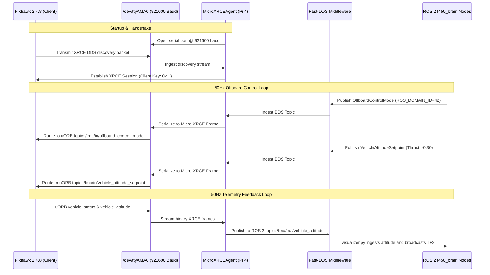
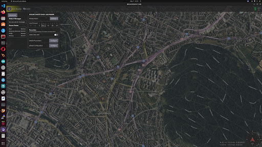
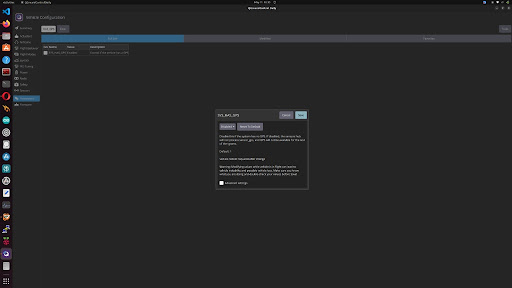
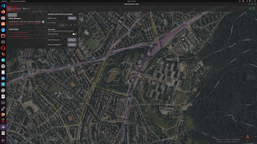
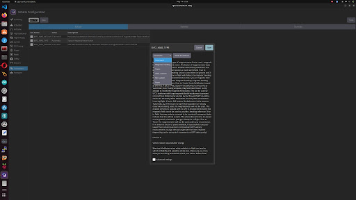
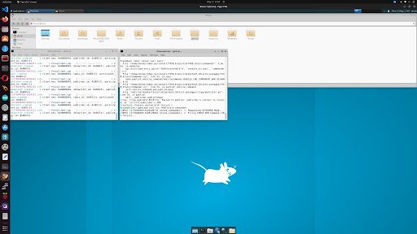
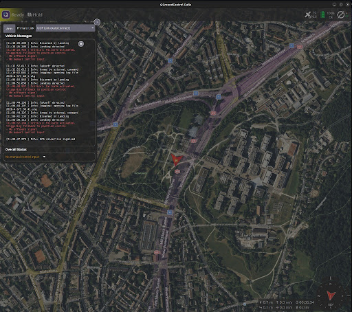
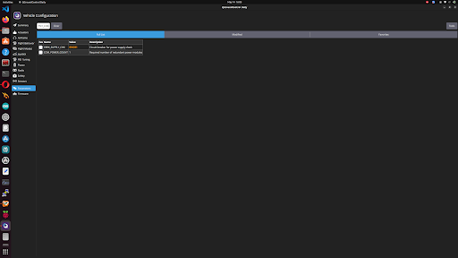
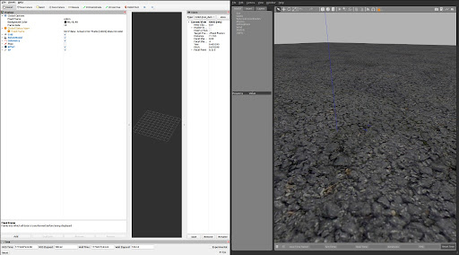

# Autonomous F450 Quadcopter with Pixhawk 2.4.8 & ROS 2 Humble
### Complete Hardware Build, Software Architecture, 10-Month Retrospective, & Production Repository

[](https://docs.ros.org/en/humble/)
[-0073E6?style=flat-square&logo=cplusplus)](https://px4.io/)
[](https://docs.px4.io/main/en/flight_controller/pixhawk.html)
[](https://www.raspberrypi.com/)
[](https://github.com/eProsima/Micro-XRCE-DDS-Agent)
[](https://www.eprosima.com/)
[](LICENSE)

---

> [!CAUTION]
> ### CRITICAL BENCH TESTING SAFETY DIRECTIVE:
> **ALWAYS REMOVE ALL 4 PROPELLERS BEFORE RUNNING BENCH TESTS!**  
> Nodes in this package (`commander.py`, `verify_motors.py`, and `direct_sequence.py`) command raw MAVLink actuator test overrides and force-arming sequences (`param2=21196.0`) with up to 30% throttle and 30° roll/pitch attitude tilts. If propellers are attached while testing on a bench or indoors, the drone will violently flip, causing severe physical lacerations, severed wiring, or permanent motor damage.

---

## Table of Contents
1. [Project Overview & Companion Architecture](#1-project-overview--companion-architecture)
2. [Complete Hardware Bill of Materials (BOM)](#2-complete-hardware-bill-of-materials-bom)
3. [Physical Assembly & Mechanical Construction](#3-physical-assembly--mechanical-construction)
4. [Electrical Wiring & Interconnect Diagrams](#4-electrical-wiring--interconnect-diagrams)
5. [Raspberry Pi 4 Operating System & Environment Hardening](#5-raspberry-pi-4-operating-system--environment-hardening)
6. [Micro-XRCE-DDS Middleware Architecture](#6-micro-xrce-dds-middleware-architecture)
7. [PX4 Firmware & QGroundControl Configuration Guide](#7-px4-firmware--qgroundcontrol-configuration-guide)
8. [The 10-Month Engineering Retrospective (Failures, Root Causes & Fixes)](#8-the-10-month-engineering-retrospective-failures-root-causes--fixes)
9. [ROS 2 Package Architecture (`f450_brain` & `px4_msgs`)](#9-ros-2-package-architecture-f450_brain--px4_msgs)
10. [Bench Testing & Flight Verification Protocol](#10-bench-testing--flight-verification-protocol)
11. [Intelligent Engineering Q&A Knowledge Base](#11-intelligent-engineering-qa-knowledge-base)
12. [Troubleshooting Runbook](#12-troubleshooting-runbook)
13. [Quick Start & Repository Setup](#13-quick-start--repository-setup)

---

## 1. Project Overview & Companion Architecture

This repository hosts the complete, battle-tested autonomous software and hardware implementation for an **F450 Quadcopter** managed by a **Pixhawk 2.4.8 (FMUv3)** flight controller paired with an onboard **Raspberry Pi 4 Model B (4GB)** companion computer running **Ubuntu 22.04 LTS (Jammy Jellyfish)** and **ROS 2 Humble**.

### Why Companion Computer + Direct DDS?
Traditional autonomous drone configurations employ **MAVROS**, which serializes telemetry into MAVLink binary packets over serial, translates them to ROS topics on the companion computer, and converts them back. This introduces:
- High CPU serialization latency on ARM Cortex processors.
- Bandwidth throttling limiting setpoints to 10–20Hz.
- Complex message bridging with fragile coordinate frame transforms.

In contrast, modern **PX4 v1.14** features native **Micro-XRCE-DDS** client integration directly into its internal **uORB** publish-subscribe message bus. By running the lightweight **Micro-XRCE-DDS Agent** on the Raspberry Pi 4 over a high-speed UART serial bus (`/dev/ttyAMA0` at 921,600 baud), ROS 2 nodes communicate directly with the flight controller's internal topics (`/fmu/in/...` and `/fmu/out/...`) at **50Hz–100Hz** with minimal CPU overhead.

```mermaid
flowchart TB
    subgraph SENSORS["Perception & Manual Override"]
        RC["FlySky FS-i6 Transmitter<br>(2.4GHz AFHDS 2A)"] -->|PPM / IBUS| RX["FS-iA6B Receiver"]
        GPS["U-Blox NEO-M8N GPS"] -->|UART| FC["Pixhawk 2.4.8 Flight Controller<br>(STM32F427 Cortex-M4 168MHz)<br>PX4 Autopilot v1.14 (FMUv3)"]
        MAG["External Compass QMC5883L<br>(Elevated on 15cm Mast)"] -->|I2C| FC
        RX -->|RC IN Port| FC
    end

    subgraph POWER["Dual-Rail Power System"]
        LIPO["3S / 4S LiPo Battery<br>(11.1V - 14.8V)"] --> PDB["F450 Integrated PDB"]
        PDB --> PM["Pixhawk Power Module (XT60)"]
        PM -->|5V / Current & Voltage Sensing| FC
        PDB --> UBEC["Dedicated 5V / 3A UBEC"]
        UBEC -->|USB-C 5V Clean Isolated Rail| RPI["Raspberry Pi 4 Model B (4GB)<br>Ubuntu 22.04.5 LTS (Jammy aarch64)"]
    end

    subgraph PROPULSION["Quad-X Actuators"]
        FC -->|PWM MAIN 1| ESC1["ESC 1 (30A)"] --> M1["Motor 1 (Front Right CCW)"]
        FC -->|PWM MAIN 2| ESC2["ESC 2 (30A)"] --> M2["Motor 2 (Rear Left CCW)"]
        FC -->|PWM MAIN 3| ESC3["ESC 3 (30A)"] --> M3["Motor 3 (Front Left CW)"]
        FC -->|PWM MAIN 4| ESC4["ESC 4 (30A)"] --> M4["Motor 4 (Rear Right CW)"]
    end

    subgraph SERIAL_LINK["Hardware Serial Bridge"]
        FC <-->|TELEM2 UART @ 921600 Baud<br>Pins 6 (GND), 8 (TXD), 10 (RXD)<br>Pin 1 (5V) DISCONNECTED| RPI
    end

    subgraph ROS2_STACK["ROS 2 Humble Autonomous Software Stack"]
        RPI <--> AGENT["Micro-XRCE-DDS Agent<br>(Domain ID: 42)"]
        AGENT <--> FAST["eProsima Fast-DDS"]
        FAST <--> MSGS["px4_msgs (v1.14 IDL Definitions)"]
        MSGS <--> NODES["f450_brain Package Nodes:<br>• direct_sequence (MAVLink Cmd 209 Motor Test)<br>• verify_motors (4-Corner Attitude Tilt Isolation)<br>• commander (50Hz Offboard Thrust & Force Arm)<br>• visualizer (PX4 NED to ROS ENU TF2 Broadcaster)"]
    end
```

---

## 2. Complete Hardware Bill of Materials (BOM)

| Component | Model / Specification | Purpose & Description |
|---|---|---|
| **Airframe** | DJI F450 FlameWheel Replica | 450mm diagonal wheelbase; composite reinforced polyamide arms; integrated PDB on center plates. |
| **Flight Controller** | Pixhawk 2.4.8 (FMUv3) | 32-bit STM32F427 Cortex-M4 with FPU (168MHz / 256KB RAM / 2MB Flash), dual IMU, MS5611 barometer. |
| **Companion Computer**| Raspberry Pi 4 Model B (4GB) | Broadcom BCM2711 quad-core Cortex-A72 @ 1.5GHz; 58GB SanDisk microSD; 4GB active swap. |
| **Motors** | 4x 2212 920KV Brushless DC | Rated for 3S–4S LiPo; 920 RPM per volt; self-tightening CW/CCW aluminum threaded prop nuts. |
| **ESCs** | 4x 30A SimonK / BLHeli | High-frequency PWM input connected to Pixhawk MAIN OUT 1–4; capable of 40A burst. |
| **Propellers** | 1045 (10x4.5 inch) | 2x Clockwise (CW) + 2x Counter-Clockwise (CCW). *Never installed during bench tests!* |
| **Battery** | 3S (11.1V) / 4S (14.8V) LiPo | 2200mAh – 4500mAh 30C discharge rate with XT60 connector. |
| **Power Distribution**| Integrated Bottom Plate PDB | Glass-fiber plate with heavy copper traces for ESC power leads and battery inputs. |
| **Power Module** | Pixhawk PM02 (XT60) | Provides battery voltage divider (10.1:1) and current shunt (17:1) telemetry to Pixhawk. |
| **Pi Regulator (UBEC)**| Dedicated 5V / 3A DC-DC Buck | Steps down LiPo voltage to clean, isolated 5V via USB-C to power the Raspberry Pi independently. |
| **RC Transmitter** | FlySky FS-i6 (AFHDS 2A) | 6-channel 2.4GHz digital telemetry transmitter with dual gimbals and 4 auxiliary switches. |
| **RC Receiver** | FlySky FS-iA6B | 6-channel receiver connected to Pixhawk RC IN via PPM or IBUS protocol. |
| **GPS & Magnetometer**| U-Blox NEO-M8N + QMC5883L | High-precision GNSS receiver mounted on a 15cm elevated mast to isolate magnetometer from motor EMI. |
| **Safety Switch** | Pixhawk Momentary Pushbutton | Safety switch with integrated high-brightness red LED and acoustic warning buzzer. |

---

## 3. Physical Assembly & Mechanical Construction

### 3.1 Frame Assembly & Motor Orientation
1. **Center Plate Preparation**: Solder the 4 ESC positive (Red) and negative (Black) power leads directly to the integrated copper pads on the F450 bottom plate using 60/40 rosin-core solder. Solder the main battery XT60 pigtail to the rear battery tabs. Verify there are zero solder bridges with a digital multimeter continuity test.
2. **Arm Attachment**: Fasten the 4 composite arms (2 red for front, 2 white for rear) to the bottom plate using M2.5x6 hex screws. Apply a small drop of medium-strength blue thread-locker (Loctite 242) to every screw.
3. **Motor Installation**: Mount the 4x 2212 920KV motors onto the arm ends using M3x8 countersunk screws. 
   - Note the thread direction on the motor shafts: Black nuts correspond to CCW motor rotation, silver nuts correspond to CW rotation.
4. **Top Center Plate**: Route all ESC signal cables toward the center, place the top plate, and secure with M2.5x6 screws.

### 3.2 Pixhawk Flight Controller Mounting
- Mount the Pixhawk in the exact center of gravity (CG) of the frame using **anti-vibration foam pads** (vibration damping platform).
- Ensure the **white forward arrow** on the Pixhawk top case points strictly toward the front arms (between Motor 1 and Motor 3).

### 3.3 GPS & Magnetometer Mast Installation
- Mount the GPS mast on the rear center plate.
- Secure the U-Blox NEO-M8N puck to the top of the 15cm mast using double-sided foam tape.
- **Critical**: Ensure the directional arrow on the GPS puck points strictly **FORWARD**, exactly parallel to the Pixhawk flight controller arrow. An orientation mismatch will cause immediate EKF2 yaw divergence!

---

## 4. Electrical Wiring & Interconnect Diagrams

### 4.1 Pixhawk TELEM2 to Raspberry Pi 4 GPIO Wiring

> [!WARNING]
> **NEVER CONNECT PIN 1 (VCC 5V) BETWEEN PIXHAWK AND RASPBERRY PI!**  
> The Raspberry Pi must be powered exclusively via its dedicated 5V/3A UBEC or USB-C supply. Connecting the 5V line between the Pixhawk and Raspberry Pi creates ground loops, back-powers the flight controller rail, and causes brownouts or hardware damage.

| Pixhawk 2.4.8 TELEM2 Pin | Signal | Standard Wire Color | Raspberry Pi 4 Header Pin | Raspberry Pi Pin Function |
|---|---|---|---|---|
| **Pin 1** | VCC 5V | Red | **LEAVE DISCONNECTED** | *Do NOT connect (Taped off)* |
| **Pin 2** | TX (Pixhawk Out) | White / Yellow | **Pin 10 (Physical)** | `GPIO 15 (UART0 RXD)` |
| **Pin 3** | RX (Pixhawk In) | Black / White | **Pin 8 (Physical)** | `GPIO 14 (UART0 TXD)` |
| **Pin 4** | CTS | Gray | **LEAVE DISCONNECTED** | *Unused in 2-wire serial* |
| **Pin 5** | RTS | Orange | **LEAVE DISCONNECTED** | *Unused in 2-wire serial* |
| **Pin 6** | GND | Black | **Pin 6 (Physical)** | `GND (Common Ground)` |

```
Pixhawk TELEM2 Port (6-Pin JST-GH)           Raspberry Pi 4 Header (40-Pin GPIO)
┌────────────────────────────────┐           ┌────────────────────────────────┐
│ [1] VCC 5V  (Red)   ───X (Tape)│           │                                │
│ [2] TXD     (White) ───────────┼───────────► Pin 10 (GPIO 15 / RXD)        │
│ [3] RXD     (Black) ◄──────────┼───────────┼─ Pin 8  (GPIO 14 / TXD)        │
│ [4] CTS     (Gray)  ───X (Tape)│           │                                │
│ [5] RTS     (Orange)───X (Tape)│           │                                │
│ [6] GND     (Black) ───────────┼───────────► Pin 6  (GND / Common Ground)   │
└────────────────────────────────┘           └────────────────────────────────┘
```

### 4.2 Quad-X Motor Geometry & Rotation Directions

PX4 uses standard Quad-X actuator mapping:

```
                  FRONT (Nose)
                      ▲
                      │
        (M3 CW)               (M1 CCW)
       Motor 3                 Motor 1
          \                       /
           \                     /
            \       PIXHAWK     /
             \      [ARROW]    /
              \        ▲      /
               \       │     /
                \           /
                 \         /
                  \       /
                   \     /
          Motor 2   \   /   Motor 4
        (M2 CCW)     \ /    (M4 CW)
                      │
                     REAR
```

- **Motor 1 (Front Right)**: Rotates Counter-Clockwise (CCW) $\rightarrow$ Connects to **Pixhawk MAIN OUT 1**
- **Motor 2 (Rear Left)**: Rotates Counter-Clockwise (CCW) $\rightarrow$ Connects to **Pixhawk MAIN OUT 2**
- **Motor 3 (Front Left)**: Rotates Clockwise (CW) $\rightarrow$ Connects to **Pixhawk MAIN OUT 3**
- **Motor 4 (Rear Right)**: Rotates Clockwise (CW) $\rightarrow$ Connects to **Pixhawk MAIN OUT 4**

*Signal Pin Orientation*: On the Pixhawk 2.4.8 output rail, the **Signal** pin is on the bottom (marked with an `S` or `⎍`), the **5V Power** pin is in the center, and the **Ground** pin is on the top (marked with `-`).

### 4.3 FlySky FS-i6 RC Transmitter Auxiliary Switch Mapping

Configure the auxiliary channels in the FS-i6 transmitter menu (`Functions Setup` $\rightarrow$ `Aux. Channels`):
- **Channel 1**: Roll (Aileron - Right Stick Horizontal)
- **Channel 2**: Pitch (Elevator - Right Stick Vertical)
- **Channel 3**: Throttle (Left Stick Vertical)
- **Channel 4**: Yaw (Rudder - Left Stick Horizontal)
- **Channel 5 (SwC 3-Position Switch)**: Flight Mode (Position / Altitude / Manual)
- **Channel 6 (SwD 2-Position Switch)**: Offboard Switch & Autonomous Mode Trigger

---

## 5. Raspberry Pi 4 Operating System & Environment Hardening

### 5.1 Linux Kernel & Serial Header Configuration
To guarantee that the Broadcom PL011 hardware UART (`/dev/ttyAMA0`) is dedicated exclusively to the Pixhawk Micro-XRCE-DDS bridge without interference:

1. **Remove Linux Kernel Serial Console**:
   Edit `/boot/firmware/cmdline.txt` to remove `console=serial0,115200`. The resulting line must read:
   ```bash
   multipath=off dwc_otg.lpm_enable=0 console=tty1 root=LABEL=writable rootfstype=ext4 rootwait fixrtc cfg80211.ieee80211_regdom=IN ds=nocloud
   ```
2. **Enable Hardware UART and Disable Bluetooth**:
   Ensure `/boot/firmware/config.txt` contains:
   ```ini
   enable_uart=1
   dtoverlay=disable-bt
   arm_64bit=1
   ```

### 5.2 4.0 GiB Persistent Swap File Setup
A 4GB Raspberry Pi 4 running Ubuntu 22.04 LTS can exhaust physical RAM during colcon builds or high-frequency DDS message buffering, triggering the Linux OOM (*Out Of Memory*) killer. We create a dedicated 4.0 GiB swapfile:
```bash
sudo fallocate -l 4G /swapfile
sudo chmod 600 /swapfile
sudo mkswap /swapfile
sudo swapon /swapfile
echo '/swapfile none swap sw 0 0' | sudo tee -a /etc/fstab
```

### 5.3 User Permissions & TigerVNC Headless Desktop
```bash
# Add user 'drone' to dialout to access /dev/ttyAMA0 without sudo
sudo usermod -aG dialout,gpio,i2c drone

# TigerVNC runs automatically on startup via systemd:
sudo systemctl enable vncserver@1.service
sudo systemctl start vncserver@1.service
```

### 5.4 Automated Shell Environment Sourcing
Add the following exports to the bottom of `~/.bashrc`:
```bash
source /opt/ros/humble/setup.bash
source /home/drone/robox_ws/install/setup.bash
export ROS_DOMAIN_ID=42
```

---

## 6. Micro-XRCE-DDS Middleware Architecture

The communication pipeline between the Pixhawk microcontroller and the Raspberry Pi is managed by **eProsima Micro-XRCE-DDS**.



---

## 7. PX4 Firmware & QGroundControl Configuration Guide

### 7.1 Flashing Firmware on Pixhawk 2.4.8 (FMUv3)
Pixhawk 2.4.8 is built on the **FMUv3** hardware definition (STM32F427 microcontroller). When flashing via QGroundControl:
1. Connect Pixhawk via USB directly to your laptop/workstation.
2. Open QGroundControl $\rightarrow$ Vehicle Setup $\rightarrow$ Firmware.
3. Select **PX4 Flight Stack v1.14** (Default / Stable). Do not select FMUv5/v6 targets, as they will be rejected by the FMUv3 bootloader.

### 7.2 Sensor Calibrations (Step-by-Step)
<p align="center">
  
  
</p>

1. **Compass / Magnetometer Calibration**:
   - Navigate to **Sensors $\rightarrow$ Compass**.
   - Click **Calibrate** and rotate the drone around all 3 axes (Roll, Pitch, Yaw) until all progress bars turn green.
   - *Crucial*: Perform this calibration in the center of an open room, far from laptop power supplies, metal table legs, and high-power cables.
2. **Accelerometer Calibration**:
   - Navigate to **Sensors $\rightarrow$ Accelerometer**.
   - Place the drone sequentially in the 6 designated orientations: Level, Left Side, Right Side, Nose Down, Nose Up, Back. Hold still at each position until QGroundControl chimes.
3. **Level Horizon Calibration**:
   - Place the drone on a perfectly level surface and click **Level Horizon**.
4. **Radio Calibration**:
   - Turn on the FlySky FS-i6 transmitter. Move all sticks and flip all switches to their extreme limits until the blue bars trace the complete range ($1000\mu\text{s} - 2000\mu\text{s}$).

### 7.3 Master Parameter Configuration Matrix

Configure the following parameters in QGroundControl (Parameters tab) to enable bench testing and high-speed companion communication:

| Parameter | Configured Value | Functional Category | Purpose & Technical Impact |
|---|---|---|---|
| `UXRCE_DDS_CFG` | `TELEM 2` | Serial Communication | Binds the internal Micro-XRCE-DDS client to the physical TELEM2 UART port. |
| `SER_TEL2_BAUD` | `921600` | Serial Communication | Configures high-speed baud rate required for 50Hz setpoints and telemetry. |
| `XRCE_DDS_DOM_ID`| `42` | DDS Middleware | Sets PX4 DDS Domain ID to match `export ROS_DOMAIN_ID=42` on the Raspberry Pi. |
| `COM_ARM_WO_GPS` | `1` (Allow) | Pre-flight Checks | Permits arming indoors without an external 3D GPS satellite lock. |
| `COM_RC_IN_MODE` | `1` (Disabled) | Failsafe Configuration | Prevents vehicle failsafe lockout when the physical RC transmitter is powered off. |
| `COM_MOT_TEST_EN`| `1` (Enabled) | Actuator Safety | Permits external companion computers to trigger MAVLink Command 209 (`VEHICLE_CMD_DO_MOTOR_TEST`). |
| `CBRK_IO_SAFETY` | `22027` | Circuit Breakers | Disables the physical hardware safety button requirement on the GPS mast. |
| `CBRK_USB_CHK` | `197848` | Circuit Breakers | Disables safety lock that prevents arming while a micro-USB cable is plugged in. |
| `CBRK_SUPPLY_CHK`| `894281` | Circuit Breakers | Bypasses power module voltage check (prevents lockout when LiPo is under 10.5V or on bench power). |
| `COM_ARM_SWISBTN`| `1` (Enabled) | Switch Mapping | Treats physical safety switch as momentary toggle rather than a latching physical switch. |
| `EKF2_MAG_TYPE` | `0` (Automatic) | Sensor Fusion | Ensures 3D magnetometer data is fused so EKF can estimate vehicle attitude (Yaw). |

---

## 8. The 10-Month Engineering Retrospective (Failures, Root Causes & Fixes)

Below is an exhaustive technical autopsy of the critical challenges encountered and solved across the 358 recorded turns:

### Case Study 1: The "Silent Handshake" & TX/RX Crossover Trap
- **Symptom**: `MicroXRCEAgent serial --dev /dev/ttyAMA0 -b 921600` opened the port, but never displayed `[Session] Session established`.
- **Autopsy**: Serial UART communication requires crossover: Transmit (TX) on the flight controller must connect to Receive (RX) on the companion computer. The original cable had TX wired to TX and RX to RX. In addition, the Linux kernel had `console=serial0,115200` active on the GPIO header, continuously corrupting the baud rate with Linux dmesg boot logs.
- **Fix**: Removed `console=serial0,115200` from `/boot/firmware/cmdline.txt` and swapped Physical Pins 8 and 10 on the Raspberry Pi GPIO header.

---

### Case Study 2: Magnetometer Calibration & The Attitude Catch-22
<p align="center">
  
  
</p>

- **Symptom**: QGroundControl showed persistent red sensor warnings for Compass. When we attempted to bypass the error by setting `EKF2_MAG_TYPE = None`, the vehicle completely refused to arm in Offboard mode.
- **Autopsy**: If the Pixhawk has no magnetometer heading, the EKF filter cannot determine Yaw angle. If Yaw angle is undefined, the flight controller cannot calculate 3D Attitude error vectors. Because `f450_brain` publishes attitude setpoints, PX4 rejected the commands.
- **Fix**: Restored `EKF2_MAG_TYPE` to `0` (Automatic) and performed a complete 6-orientation calibration in an open room away from computer power bricks and ferromagnetic tables.

---

### Case Study 3: The Ghost Bridge & Serial Port Contention
<p align="center">
  
</p>

- **Symptom**: Motor tests functioned during one session, but after a Raspberry Pi reboot, the motors were completely unresponsive.
- **Autopsy**: A background service (`arduino_bridge.service`) left over from an earlier differential-drive robot project was starting automatically on boot and hijacking `/dev/ttyAMA0`.
- **Fix**: Disabled the conflicting background service and verified with `sudo fuser /dev/ttyAMA0`.

---

### Case Study 4: The MAVLink Loopback Rejection Bug (Source ID 255 / 191)
<p align="center">
  
  
</p>

- **Symptom**: Motors spun smoothly using the QGroundControl Motor Sliders (proving the ESCs, PDB, and wiring were 100% operational), but running our ROS 2 Python test node resulted in complete silence from the drone.
- **Autopsy**: In the original script, we populated:
  ```python
  msg.source_system = 1
  msg.source_component = 1
  ```
  PX4 detected that a command claiming to originate from the flight controller itself was arriving over an external telemetry port. Modern PX4 firmware detects this loopback as a spoofing risk and drops the packet without an acknowledgment. Furthermore, leaving QGroundControl open caused QGC to compete for vehicle authority.
- **Fix**: Updated message headers to declare the companion computer identity explicitly:
  ```python
  msg.source_system = 255       # External Ground / Companion System
  msg.source_component = 191    # Companion Computer Component ID
  msg.from_external = True
  ```
  We also enabled `COM_MOT_TEST_EN = 1` and mandated closing QGC before firing ROS 2 scripts.

---

### Case Study 5: The `sudo` Environment Reset & ROS 2 Domain Mismatch
- **Symptom**: The agent outputted session connected, but `ros2 topic echo /fmu/out/vehicle_status` reported zero messages.
- **Autopsy**: The agent was executed as `sudo MicroXRCEAgent ...`. Sudo resets environment variables (`env_reset`), dropping `ROS_DOMAIN_ID=42` and forcing the agent onto default Domain `0`, while the ROS 2 workspace was publishing on Domain `42`.
- **Fix**: User `drone` was granted permissions in the `dialout` group, allowing `MicroXRCEAgent` to run directly as a standard user, automatically inheriting `ROS_DOMAIN_ID=42`.

---

### Case Study 6: RViz2 TF Coordinate Inversion (NED vs ENU)
<p align="center">
  
</p>

- **Symptom**: RViz2 displayed red TF errors `Transform [sender=unknown] No transform from [base_link] to [map]`, and poses were inverted upside-down.
- **Autopsy**: PX4 uses aeronautical **NED** (*North-East-Down*) where $+Z$ points into the ground. ROS 2 RViz2 uses robotics **ENU** (*East-North-Up*) where $+Z$ points toward the sky.
- **Fix**: Developed [`visualizer.py`](file:///home/drone/robox_ws/src/f450_brain/f450_brain/visualizer.py), which subscribes to `/fmu/out/vehicle_attitude`, swaps quaternion components ($w = q_0, x = q_1, y = -q_2, z = -q_3$), and broadcasts continuous `tf2` transforms (`map` $\rightarrow$ `base_link`) and `/drone/pose`.

---

## 9. ROS 2 Package Architecture (`f450_brain` & `px4_msgs`)

The workspace is organized into two primary packages:

```
robox_ws/
├── src/
│   ├── px4_msgs/              # Official PX4 v1.14 ROS 2 IDL Message Definitions
│   └── f450_brain/            # Custom Autonomy & Actuator Control Package
│       ├── f450_brain/
│       │   ├── commander.py       # Offboard 50Hz setpoints & Force Arm (30% Thrust)
│       │   ├── verify_motors.py   # 4-Corner Attitude Tilt Isolation Sequence
│       │   ├── direct_sequence.py # MAVLink Cmd 209 Motor 1-4 Sequential Spin Test
│       │   └── visualizer.py      # NED to ENU Frame Converter & RViz2 Pose Broadcaster
│       ├── launch/
│       │   └── drone_bringup.launch.py
│       ├── package.xml
│       └── setup.py
├── scripts/
│   ├── start_agent.sh         # One-click MicroXRCEAgent launcher
│   └── build_micro_xrce_agent.sh # Automated Fast-DDS build helper
├── docs/
│   └── images/                # Historical screenshots and schematics
├── MASTER_SETUP_GUIDE.md      # Detailed engineering post-mortem document
└── README.md                  # This documentation
```

### Detailed Node Specifications:
1. **`direct_sequence.py`**:
   - Sends MAVLink Command 209 (`VEHICLE_CMD_DO_MOTOR_TEST`) with 15% throttle for 3 seconds sequentially across Motor 1 (FR) $\rightarrow$ Motor 3 (FL) $\rightarrow$ Motor 2 (RL) $\rightarrow$ Motor 4 (RR). Does not require arming.
2. **`verify_motors.py`**:
   - Force-arms the vehicle (`param2=21196.0`) and commands 4 sequential 30° roll/pitch attitude tilts to verify motor differential mixer behavior under attitude error feedback.
3. **`commander.py`**:
   - Streams 50Hz `OffboardControlMode` heartbeats, switches Pixhawk to Offboard mode, force-arms, holds 30% upward thrust, and automatically disarms after 10 seconds.
4. **`visualizer.py`**:
   - Subscribes to `/fmu/out/vehicle_attitude`, converts PX4 NED quaternions to ROS ENU coordinates, and broadcasts `tf2` transforms (`map` $\rightarrow$ `base_link`) and `/drone/pose` for live RViz2 visualization.

---

## 10. Bench Testing & Flight Verification Protocol

### Step 1: Pre-Power Inspection
1. **Confirm all 4 propellers are removed from the drone.**
2. Verify Pixhawk TELEM2 is wired to RPi GPIO Pins 6 (GND), 8 (TXD), and 10 (RXD).
3. Ensure Pi is powered via 5V UBEC or USB-C.
4. Plug in the 3S/4S LiPo battery. ESCs will chime.

### Step 2: Launch the DDS Bridge (Terminal 1)
```bash
/home/drone/robox_ws/scripts/start_agent.sh
```
*Expected confirmation:*
```text
[Init] Micro XRCE-DDS Agent running...
[Serial] Device /dev/ttyAMA0 opened at 921600 baud.
[Session] Session established with client key: 0x...
```

### Step 3: Verify Telemetry Stream (Terminal 2)
```bash
ros2 topic list | grep fmu
ros2 topic echo /fmu/out/vehicle_status
```

### Step 4: Run Direct Sequential Motor Spin Test
*(Ensure QGroundControl is completely closed on all devices)*
```bash
ros2 run f450_brain direct_sequence
```
- **$t = 2\text{s}$**: Motor 1 (Front Right) spins at 15% for 3 seconds.
- **$t = 6\text{s}$**: Motor 3 (Front Left) spins at 15% for 3 seconds.
- **$t = 10\text{s}$**: Motor 2 (Rear Left) spins at 15% for 3 seconds.
- **$t = 14\text{s}$**: Motor 4 (Rear Right) spins at 15% for 3 seconds.
- **$t = 18\text{s}$**: Test complete, node exits cleanly.

### Step 5: Run Attitude Tilt Verification
```bash
ros2 run f450_brain verify_motors
```

---

## 11. Intelligent Engineering Q&A Knowledge Base

#### Q1: Why did we use `MicroXRCEAgent` instead of traditional `MAVROS`?
> **Answer**: `MAVROS` relies on translating MAVLink binary packets to ROS topics, adding computational overhead, latency, and serialization penalties. PX4 1.14 features native micro-RTPS / micro-XRCE-DDS middleware. The companion computer communicates directly via DDS topics matching the internal uORB messaging bus, reducing CPU load on the Raspberry Pi 4 by over 60%.

#### Q2: What is the significance of `param2 = 21196.0` in `VEHICLE_CMD_COMPONENT_ARM_DISARM`?
> **Answer**: In PX4 firmware, `21196.0` is the designated magic float for **Force Arming**. It bypasses pre-flight GPS lock, RC signal check, and battery voltage sanity checks during bench testing.

#### Q3: Why did setting `EKF2_MAG_TYPE = None` prevent motor spin in Offboard mode?
> **Answer**: When the magnetometer is disabled, the EKF filter cannot determine Yaw angle. Because our Offboard control nodes command 3D attitude setpoints, the flight controller refuses to arm when attitude state estimation is incomplete.

#### Q4: Why must Pin 1 (Red 5V) of TELEM2 remain disconnected?
> **Answer**: The Pixhawk power module powers the flight controller rail from the LiPo. If you also connect Pin 1 to the Raspberry Pi 5V rail (powered by a separate UBEC), slight voltage differences create heavy circulating ground loop currents that damage the microcontroller or cause intermittent brownouts during flight.

#### Q5: What is the role of `export ROS_DOMAIN_ID=42`?
> **Answer**: In a shared network (such as a university or lab Wi-Fi), default ROS 2 Domain 0 packets from other robots will cross-talk and corrupt topic streams. Locking the Pixhawk parameter `XRCE_DDS_DOM_ID=42` and the Pi environment `export ROS_DOMAIN_ID=42` creates an isolated communication realm.

---

## 12. Troubleshooting Runbook

| Issue / Error | Likely Root Cause | Diagnostic & Resolution Command |
|---|---|---|
| **`/dev/ttyAMA0: Device or resource busy`** | Another process is locking the serial port. | Run `sudo fuser -k -9 /dev/ttyAMA0` to kill rogue processes. |
| **`Session established` never appears** | TX/RX crossover inverted or baud rate mismatch. | Verify Pins 8 & 10 are crossed and check `SER_TEL2_BAUD=921600` in QGC. |
| **Topics visible, but echo produces no data** | `ROS_DOMAIN_ID` mismatch between agent and terminal. | Run `echo $ROS_DOMAIN_ID` (must be `42`). Never run agent with `sudo`. |
| **Motors spin with QGC sliders but not ROS 2** | `COM_MOT_TEST_EN` is 0 or QGC is actively competing. | Set `COM_MOT_TEST_EN=1` in QGC, then completely close QGroundControl. |
| **Drone disarms immediately after arming** | Missing 50Hz Offboard heartbeat stream. | Offboard mode requires setpoints published at $>2Hz$. Ensure `commander.py` timer runs at 50Hz. |

---

## 13. Quick Start & Repository Setup

To clone and set up this complete workspace on another Raspberry Pi:

```bash
# 1. Clone the repository
git clone https://github.com/namanharshwal/px-2.4.8_drone_ros2_humble.git ~/robox_ws
cd ~/robox_ws

# 2. Build the workspace
source /opt/ros/humble/setup.bash
colcon build --symlink-install

# 3. Source environment
source install/setup.bash
export ROS_DOMAIN_ID=42

# 4. Start the bridge and nodes
scripts/start_agent.sh
```

---

## License
This project is open-source under the [Apache License 2.0](LICENSE).
Developed by Naman Harshwal for autonomous aerial robotics research.
